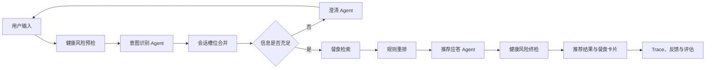

# Diet Agent

一个面向“今天吃什么”场景的多 Agent 智能饮食推荐系统。项目基于 Spring Boot、AgentScope 与 DeepSeek 构建，通过意图识别、槽位澄清、餐食检索、规则重排和自然语言生成，为用户提供可解释的单餐推荐与三餐规划。

> 本项目提供的是日常饮食选择参考，不能替代医生、营养师或其他专业人士的诊断与建议。

## 项目亮点

- **多轮对话推荐**：结合会话历史持续补全餐次、心情、场景、健康目标、菜系、口味和便利性偏好。
- **多 Agent 协作**：拆分意图识别、澄清追问、推荐表达和评估判断，降低单次提示词的复杂度。
- **检索与重排**：先从 MySQL 餐食库召回候选，再按用户槽位命中程度进行规则打分与排序。
- **单餐与三餐规划**：支持早餐、午餐、晚餐等单餐推荐，也可以一次生成早餐、午餐和晚餐方案。
- **公共库与个人库**：可以使用内置公共餐食，也支持用户维护自己的私人餐食集合。
- **健康风险守卫**：识别医疗承诺、极端节食、特殊人群与慢病等高风险内容，并返回保守提示。
- **可观测与评估闭环**：记录请求 Trace、Agent 调用、延迟、用户反馈和评估结果，便于调试与优化。
- **开箱即用的 Web 界面**：内置对话、餐食管理、Trace 查询和评估页面，无需单独部署前端。

## 工作流程



## 技术栈

| 模块 | 技术 |
| --- | --- |
| 后端 | Java 21、Spring Boot 3.3 |
| Agent 框架 | AgentScope Java |
| 大模型 | DeepSeek（OpenAI 兼容接口） |
| 数据访问 | MyBatis |
| 数据库 | MySQL 8 |
| 前端 | 原生 HTML、CSS、JavaScript |
| 构建与测试 | Maven、JUnit 5、Mockito |

## 项目结构

```text
diet-agent/
├── docs/                              # 架构图（Draw.io）
├── src/main/java/com/diet/
│   ├── agent/                         # Agent 构建、工厂与 Prompt 加载
│   ├── controller/                    # 对话、餐食、反馈、Trace、评估 API
│   ├── service/
│   │   ├── orchestrator/              # 多 Agent 状态机编排
│   │   ├── intent/                    # 意图识别与修正
│   │   ├── clarify/                   # 槽位判断与澄清
│   │   ├── meal/                      # 检索、重排与三餐规划
│   │   ├── recommend/                 # 推荐理由和回复生成
│   │   ├── risk/                      # 健康风险守卫
│   │   ├── trace/                     # 链路追踪
│   │   └── evaluation/                # 推荐效果评估
│   └── model/                         # 请求、响应与领域模型
├── src/main/resources/
│   ├── db/                            # 数据库结构与示例餐食
│   ├── diet/prompts/                  # Agent Prompt 模板
│   ├── mapper/                        # MyBatis XML
│   ├── static/                        # 内置 Web 界面
│   └── application.yml                # 应用配置
└── src/test/                          # 单元测试
```

## 快速开始

### 1. 环境要求

- JDK 21
- Maven 3.9+
- MySQL 8.x
- DeepSeek API Key

### 2. 初始化数据库

登录 MySQL 后执行：

```sql
CREATE DATABASE IF NOT EXISTS diet_db
  DEFAULT CHARACTER SET utf8mb4
  COLLATE utf8mb4_unicode_ci;

USE diet_db;
SOURCE E:/Mycode/diet-agent/src/main/resources/db/diet_db.sql;
SOURCE E:/Mycode/diet-agent/src/main/resources/db/add_40_meal_items.sql;
```

请将上面的路径替换为本机项目路径。第一个 SQL 文件创建表并写入基础数据，第二个 SQL 文件补充更多公共餐食。

### 3. 配置环境变量

PowerShell：

```powershell
$env:DB_PASSWORD = "你的 MySQL 密码"
$env:DEEPSEEK_API_KEY = "你的 DeepSeek API Key"
```

Bash：

```bash
export DB_PASSWORD="你的 MySQL 密码"
export DEEPSEEK_API_KEY="你的 DeepSeek API Key"
```

可选配置：

| 环境变量 | 默认值 | 说明 |
| --- | --- | --- |
| `DB_URL` | `jdbc:mysql://localhost:3306/diet_db...` | MySQL JDBC 地址 |
| `DB_USERNAME` | `root` | MySQL 用户名 |
| `DB_PASSWORD` | 空 | MySQL 密码 |
| `DEEPSEEK_API_KEY` | 空 | DeepSeek API Key |
| `DEEPSEEK_BASE_URL` | `https://api.deepseek.com` | OpenAI 兼容 API 地址 |
| `DEEPSEEK_MAIN_MODEL` | `deepseek-chat` | 推荐回复模型 |
| `DEEPSEEK_LIGHT_MODEL` | `deepseek-chat` | 意图识别与澄清模型 |

### 4. 启动应用

```bash
mvn spring-boot:run
```

打开 [http://localhost:8080](http://localhost:8080) 即可进入 Web 界面。

## API 示例

创建会话：

```bash
curl -X POST "http://localhost:8080/api/v1/diet/sessions" \
  -H "X-User-Id: 1"
```

发起推荐对话：

```bash
curl -X POST "http://localhost:8080/api/v1/diet/chat" \
  -H "Content-Type: application/json" \
  -H "X-User-Id: 1" \
  -d '{
    "sessionId": "替换为创建会话后返回的 ID",
    "message": "今天晚餐想吃清淡一点的高蛋白食物",
    "sourceMode": "PUBLIC",
    "context": {}
  }'
```

`sourceMode` 可选值：

- `PUBLIC`：从公共餐食库检索。
- `PERSONAL`：仅从当前用户维护的个人餐食库检索。

主要接口：

| 方法 | 路径 | 用途 |
| --- | --- | --- |
| POST | `/api/v1/diet/sessions` | 创建会话 |
| POST | `/api/v1/diet/chat` | 多轮推荐对话 |
| GET/POST | `/api/v1/diet/meals/personal` | 查询或创建个人餐食 |
| PUT/DELETE | `/api/v1/diet/meals/personal/{mealId}` | 更新或删除个人餐食 |
| GET | `/api/v1/diet/meals/public` | 查询公共餐食 |
| POST | `/api/v1/diet/feedback` | 保存推荐反馈 |
| GET | `/api/v1/diet/debug/traces` | 查询请求 Trace |
| POST | `/api/v1/diet/evaluations` | 运行推荐效果评估 |

## 测试

```bash
mvn test
```

当前测试覆盖三餐规划的分餐次检索、排序和结果聚合。后续可以继续补充状态机、风险守卫、Mapper 和 Controller 集成测试。

## 安全说明

- 不要把数据库密码或 API Key 直接写入 `application.yml`。
- 推荐使用环境变量，或创建被 `.gitignore` 排除的 `application-local.yml`。
- 健康风险守卫是产品级保护措施，不应被视为医疗安全认证。
- 若密钥曾被提交到 Git 历史，请立即撤销并重新生成；仅删除文件中的明文并不能清除历史记录。

## 架构资料

可使用 Draw.io 打开 [`docs/diet-agent-architecture.drawio`](docs/diet-agent-architecture.drawio) 查看项目架构源文件。
