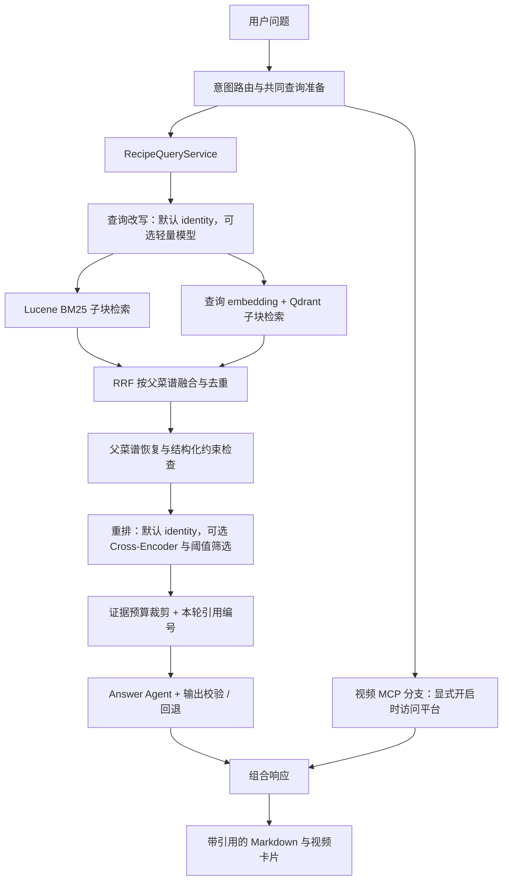

# Diet Agent 菜谱 RAG 与视频 MCP：实现复盘及面试逐字稿

> 整理日期：2026-10-10；2026-10-19 更新相关性筛选接入状态。面向 Java 后端 / Agent / RAG 相关面试。
>
> 文中的 **【面试逐字稿】** 可以直接口述；其他内容用于理解实现、准备追问。
>
> 依据当前代码、冻结 v2 数据集、现存检索报告与验收记录整理。2026-10-10 补充可选查询改写实现；未重新运行检索性能实验、真实改写对照或真实 Ragas Judge。历史测量结果均标明口径；尚未验证的收益不写成成果。

## 1. 先记住这条项目主线

这是一套 Spring Boot + AgentScope Java 的饮食助手练习项目。用户有两种不同需求：一是“今天吃什么”，二是“这道菜怎么做”。

- **餐食推荐**：查询用户的 MySQL 餐食库，使用结构化条件筛选。
- **公共菜谱问答**：检索固定版本的 HowToCook 文档，基于本轮证据生成带引用的做法。
- **教学视频**：通过 Bilibili MCP 查找可点击的视频，作为菜谱问答的伴随结果。
- **个人已保存做法**：仍在 MySQL `meal_knowledge` 中，不进入公共 Lucene / Qdrant 索引；本轮没有新增个人文档上传或解析产品流程。

项目借鉴 All-in-RAG 的 RAG 思路，但公共菜谱正文直接来自 HowToCook，实现采用 Java 技术栈。当前没有接入 MinerU，也没有做视频字幕抽取或视频内容理解。

### 【面试逐字稿｜90 秒项目介绍】

> 我做的是一个饮食助手。原来主要解决吃什么的问题，后来我发现用户选定一道菜以后，还会继续问怎么做，所以我把餐食推荐和菜谱问答拆成了两个数据域。
>
> 推荐继续查 MySQL，菜谱问答使用固定版本的 HowToCook 做知识库。检索采用 Lucene BM25 和向量检索并行召回，再通过 RRF 融合，按菜谱去重并展开父文档，让模型拿到相对完整的食材和步骤。回答要求引用本轮证据，不能编热量或原文没写的替换方案。
>
> 检索前我还实现了一个默认关闭的轻量查询改写。它用 AgentScope 的轻量模型做一次无记忆、无工具调用的结构化改写，主要处理错别字、口语和别名；服务端解析出的食材、工具和时间约束不允许被模型修改。改写失败会直接回退原查询，并在 Trace 中记录实际使用的查询。
>
> 我比较重视评测。最初的标注集每条问题基本只有一个正确答案，宽泛问题容易误判，所以我单独版本化了一套 v2 数据集，补了多答案、不同相关等级和接近菜谱领域的无答案问题，并拆开检索预期和回答预期。
>
> 在锁定测试集上，并行 Hybrid 与串行方案的质量相同，检索 P95 从 42 毫秒降到 31 毫秒。不过 Dense 的排名指标反而更好，near-OOD 也暴露出 top-k 强行召回的问题，所以我没有把混合检索说成全面更优。
>
> 此外我通过 MCP 接入 B 站教学视频，菜谱和视频独立并行，任一分支失败都能保留另一支结果。Ragas 的离线评测工具链已经实现，但真实 Judge 基线还没有跑，因此我不会拿它报一个没有测过的分数。

## 2. 技术栈与职责

| 组件 | 在项目中负责什么 | 选择理由与边界 |
| --- | --- | --- |
| Java 21、Spring Boot 3.3.13 | HTTP 服务、配置和业务编排 | 与原有后端一致；现有 Maven 编译目标仍为 release 17，不应说所有代码都使用 Java 21 语法 |
| AgentScope Java 1.0.11 | 回答 Agent、embedding 适配、MCP client | 复用 Agent 生命周期与模型调用；框架有 embedding 抽象，不等于自带可用的 embedding 服务 |
| MyBatis / MySQL | 餐食推荐、个人做法 | 保存结构化业务数据；推荐不依赖 embedding |
| Lucene 9.12.3 | BM25 关键词召回 | 本地嵌入式索引；当前使用 StandardAnalyzer，没有接入专用中文分词器 |
| Ollama + `bge-m3:567m` | 菜谱文本和查询向量化 | 当前已配置的本地 embedding 运行方式；向量维度为 1024 |
| Qdrant | 子块向量存储与相似度检索 | Cosine 距离、索引版本过滤；当前语料规模不足以证明大规模性能 |
| Reactor | 两层并行与错误隔离 | BM25 / Dense 并行；菜谱 / 视频并行 |
| Ragas 0.4.3 + Python / uv | 离线回答语义评测 | 与 Java 服务通过 JSONL 解耦，依赖可复现 |
| 固定版本 Bilibili MCP Server | 教学视频搜索 | Java client 调用现成工具；没有自研 MCP server |

**当前能力边界**：查询改写与重排默认仍为 identity。现已接入可选的 Cross-Encoder HTTP 重排和阈值筛选，完成本地协议与故障测试，但没有 Rerank Key，真实模型效果和阈值尚未验证，不能宣称已在线启用或取得指标提升。改写的真实 dev 对照也尚未运行；未实现 Agent 自主多轮检索或自动选择视频工具。操作见[相关性筛选指南](../guides/recipe-relevance.md)。

### 【面试逐字稿｜为什么不全部用 MySQL，或者全部用向量库？】

> 我按数据和查询方式来分工。餐食推荐里的餐次、食材限制和用户归属都是结构化条件，MySQL 更合适。菜谱问答有别名、口语、做法描述，纯关键词不容易覆盖，所以增加语义检索。
>
> 向量相似不代表满足业务约束，也不适合替代用户数据的事务管理。因此我只把公共菜谱写入检索索引，推荐和个人做法仍留在 MySQL。这样 embedding 不可用时，也不会影响餐食推荐。

## 3. 菜谱 RAG 是怎么实现的

### 3.1 整体链路



这里有**两层并行**：内层负责关键词与语义召回，外层负责文字菜谱与教学视频。外层不等待 RAG 找到答案后再从答案里提取菜名；两支在启动前共享准备好的查询。

### 3.2 查询改写怎么做

查询改写位于菜谱意图路由之后、两路检索之前。开启 `diet.recipe-rag.query-rewrite.enabled=true` 后，系统复用 `DietLightChatModel`，发送一条 system prompt 和用户原查询，不带历史消息，也不给工具。模型只允许返回：

```json
{"query":"酸辣土豆丝 做法"}
```

实现上做了四层约束：

1. 生成参数使用 temperature 0、最多 128 tokens、一次尝试和独立超时。
2. 返回值必须是只含 `query` 的 JSON 对象；空文本、额外字段、尾随内容或超长内容都按失败处理。
3. 模型只能改检索文本。`requiredIngredients`、`excludedIngredients`、`requiredTools`、`maxMinutes` 始终复制服务端解析的原值，防止模型增加或放松硬约束。
4. 检索使用 effective query；重排和回答生成使用指代解析后的 original query，避免把“原文没写就拒绝”等要求在改写时丢掉。

同步异常、异步异常、超时和解析失败统一回退原查询。Trace 记录 `originalQuery`、`effectiveQuery`、`REWRITTEN/UNCHANGED/FALLBACK`、模型名、耗时和异常类型；一次改写失败不会把整轮请求标成失败。

### 【面试逐字稿｜查询改写为什么没有做成 Agentic RAG？】

> 我先把问题限定为检索前的 query normalization，所以只做一次无状态模型调用。它主要解决错别字、别名和长口语，不需要规划、调用工具或反复检索。这样延迟和故障面更可控，也方便做原查询与改写查询的成对评测。
>
> 我没有让模型改结构化约束，因为“不要花生”和“15 分钟内”属于业务硬条件。模型即使返回了新条件，服务端也会丢弃。检索用改写文本，回答仍看原问题；改写失败则回退原查询。因此它是一个可降级的召回增强阶段，而不是新的单点依赖。

真实改写另有 dev-only 对照入口，保存每条 original/effective query、两套 Top10、Gold、改写耗时和聚合指标。当前尚未运行带真实模型的对照，因此只能描述实现和评测方法，不能报改写收益。

### 3.3 离线语料导入与解析

公共语料固定为 HowToCook `1.6.0`，commit：

```text
a0b14bd388ee996943173679c3a7c9db7da04a6c
```

导入器扫描 `dishes/` 下的 Markdown，排除 README、索引页和隐藏路径。解析标题、别名、食材与工具、步骤及章节。当前解析器要求能提取食材和步骤，无法解析的文档不会进入索引。

本次历史评测实际导入 **334 篇父菜谱**。这代表生产解析器可用的文档数，不是仓库全部 Markdown 文件数。标注过程中发现有些文件虽存在，却不符合当前解析方式，因此不能把它们直接当作可召回的 Gold。

每篇菜谱保存：来源 commit、相对路径、内容哈希、父文档 ID。父 ID 由 commit、路径和内容哈希计算得到：相同输入可复现；内容或语料版本变化时 ID 也会变化。

### 3.4 为什么做父子分块

父文档是一整道菜；子块按简介、食材工具、用量计算、步骤、附加说明拆分。长章节继续切分：

- 每块最多 **1200 字符**，包含菜名和章节前缀。
- 重叠 **120 字符**。
- 优先在换行或中文标点附近切分，必要时硬切。

检索以子块为单位，最终恢复对应父菜谱。因为用户问“怎么做”时，只返回一个步骤片段可能漏掉食材或前置准备。恢复父菜谱后，证据组装器仍会受预算约束，因此不能理解为每次都把全部正文送入模型。

### 【面试逐字稿｜为什么不直接把整篇菜谱向量化？】

> 整篇向量化的上下文完整，但长文会混合很多信息，比如食材、步骤和注意事项，用户只问某个步骤时不容易精准命中。只检索小块又可能丢前后文。
>
> 我采用子块检索、父菜谱恢复：先用比较小的章节块提高召回粒度，再恢复同一道菜的食材和步骤，按预算组装证据。分块参数目前是 1200 字符和 120 字符重叠，它们是工程基线，还没有通过独立实验找到最优值。

### 3.5 双索引构建与版本

同一批子块分别写入 Lucene 和 Qdrant。Qdrant 保存父子 ID、向量与索引版本等元数据，查询带当前版本过滤。

索引版本由语料哈希、解析器版本、embedding 模型和维度共同形成。构建流程先准备向量、暂存两套索引、校验，然后激活新版本；异常时尝试恢复旧版本并清理本次构建。

这解决的是“语料、解析器或 embedding 换了，却继续使用旧索引”的可追踪问题。**它不是 Lucene 与 Qdrant 的分布式事务**：当前是顺序激活与补偿恢复，不应宣称双存储强原子切换。

### 3.6 BM25 与 Dense 并行召回

BM25 搜索菜名、别名、食材、章节和正文。Dense 先调用 embedding，再去 Qdrant 进行向量相似度检索。

默认配置：两支各取 20 个子块候选，RRF 常量为 60，生产最终最多返回 5 道父菜谱。检索分支预算默认为 2 秒；单支超时或失败会降级使用另一支，两支都失败则终止正常生成。

实现通过 `Mono.zip` 订阅独立分支，阻塞 Lucene 调用放在 `boundedElastic`。只有在两支都转成可处理的终态之后，才进行融合。

```text
串行：T ≈ T_BM25 + T_Dense + T_融合
并行：T ≈ max(T_BM25, T_Dense) + T_融合 + T_调度
```

时间公式描述无异常、资源足够时的主要路径。Dense 内部的 embedding → 向量搜索仍是依赖关系；并行不代表所有步骤都能同时进行。

### 3.7 RRF 怎么融合

BM25 分数和向量相似度尺度不同，当前用排名融合，避免直接相加原始分数：

```text
score(recipe) = Σ 1 / (60 + rank_branch(recipe))
```

本项目先在每个分支保留同一父菜谱排名最靠前的命中，再计算父菜谱的 RRF 分数。没有命中该菜谱的分支贡献为 0；同分按 ID 等稳定条件排序。

例如同一道菜在两支都排第 1，分数约为 `2/61`；只在一支排第 1，分数约为 `1/61`。因此两支共同命中的菜可能获得更高排名，也可能把 Dense 原本排名较好的菜往后挤。RRF 的稳健性不等于一定优于单支。

### 3.8 结构化约束与当前限制

查询契约支持必须食材、排除食材、工具、时间等字段；未知字段会被拒绝。父菜谱恢复后检查必须食材、排除食材和工具。

当前检查主要依赖文本包含，**尚未做完整食材实体归一化**。例如“皮蛋”与“鸡蛋”、食材别名、类别约束仍是需要专门验证的难点。自然语言中的所有限制也不会自动可靠地转成结构化字段。

`maxMinutes` 已进入契约并进行参数验证，但当前父块过滤没有实现可靠的菜谱总时长判断。不能说已经支持“20 分钟内”这样的严格时间保障；需要先从原文提取有依据的时长，处理缺失值，再做过滤。

### 3.9 证据组装、引用与回答校验

证据块使用 `[S1]`、`[S2]` 等本轮编号，包含菜名、食材、步骤、来源路径和 commit。模型被要求只依据证据回答，返回 `text / citationIds / refused` 的 JSON。

服务端检查：正文非空、引用列表存在且非空、引用 ID 属于本轮证据、正文包含对应引用标记。然后追加来源并返回 Markdown。

没有证据时拒答。模型 JSON 异常、使用未知引用或调用异常时，当前实现使用第一道检索菜谱的原文食材和步骤构造确定性回退。

**引用合法不等于语义一定正确**：这些检查能发现引用 ID 乱编，不能证明每句话都由证据支持。此外，回退读取完整父菜谱，而模型证据可能经过裁剪，两者范围可能不同。评测低忠实度时，需要区分模型生成与回退路径；目前还没有把“避免所有幻觉”做成已验证结论。

### 【面试逐字稿｜怎么控制幻觉？】

> 我分成三层。第一层是限制输入，只给本轮召回并整理过的证据。第二层是提示词和输出契约，要求引用本轮编号，热量和替换方案如果原文没写就不能补。第三层是服务端校验，拒绝不存在的引用和不符合格式的输出。
>
> 但是我不会说这三层就消除了幻觉。模型可以引用一个合法来源，却说出来源不支持的话，所以还需要忠实度评测和人工抽查。另外当前检索缺少可靠的相关性阈值，这是拒答机制里还没补完的一环。

## 4. 评测怎么设计，真实结果是什么

### 4.1 先修评测集，再比较算法

v1 有 64 条查询、8 个切片，dev 48 条、test 16 条。56 条非 OOD 样本基本都是单 Gold 且 grade=3，宽查询的正确答案范围过窄，测试菜谱也集中在少数常见菜。

典型问题：

- “五花肉怎么红烧”只认一个版本的红烧肉，其他合理菜谱会被误判。
- “不要肉”的自然语言与只排除猪肉的字段不等价。
- 检索条件混入“不要虚构热量”等回答阶段要求。
- OOD 主要是量子计算等远领域问题，无法充分考察相似菜谱误召回。

修正方式是保留 v1，新增 v2；复核实际可导入语料，增加多 Gold、等级区分、错别字、口语别名、更多菜谱与 near-OOD，并记录标注依据。不是看到某个测试没命中，就把返回结果补成正确答案。

### 4.2 v2 数据口径

| 项目 | 数量 |
| --- | ---: |
| 全量查询 | 90 |
| dev / 锁定 test | 60 / 30 |
| 有相关菜谱的检索样本 | 78 |
| 全量不同 Gold 菜谱 | 39 |
| 多 Gold 查询 | 12 |
| test 检索正例 | 26 |
| test 不同 Gold 菜谱 | 18 |
| test 回答预期 | 24 ANSWER、4 REFUSE_OUT_OF_CORPUS、2 REFUSE_UNSUPPORTED |

test 有 26 个检索正例，是因为两条“不支持所问事实”的问题仍应检索到对应菜谱。单个检索正例对宏平均的最大影响约为 `1/26 = 3.846` 个百分点，测试集仍然偏小。

dev/test 按相关菜谱的连通关系分组隔离，避免同一道 Gold 的近似问法跨集合泄漏。两边都从同一个知识库检索，这是 RAG 知识库评测，不代表模型在未知菜谱上的泛化评测。

冻结指纹：

```text
f59d67bece51a61cca10f2f70e0424f0ca42f4991003a30d59fbea1fc31de2f6
```

### 4.3 为什么拆开检索预期与回答预期

| 问题类型 | 检索预期 | 回答预期 |
| --- | --- | --- |
| “宫保鸡丁怎么做” | 找到相关菜谱 | 基于原文回答 |
| “语料里没有的菜怎么做” | 无相关结果 | 不编文字菜谱，可独立返回视频 |
| “红烧肉每 100g 精确多少千卡，只按原文回答” | 找到红烧肉 | 原文缺该事实，应拒绝编数字 |

后两种都涉及拒答，但不是同一个检索任务。如果把所有拒答样本的检索 Gold 都置空，会错误惩罚本应成功的召回。

### 4.4 指标怎么解释

| 指标 | 在本项目的定义 | 主要回答什么 |
| --- | --- | --- |
| Recall@K | 每条查询命中的相关父菜谱数 / 全部标注相关菜谱数，再宏平均 | 多答案是否召回充分 |
| MRR@10 | 首个相关结果排名的倒数，再平均 | 第一个有用结果是否靠前 |
| nDCG@10 | 使用 grade 的分级相关性折扣收益 | 更相关的菜谱是否排在前面 |
| near-OOD false-positive rate | near-OOD 中返回非空列表的比例 | 检索会不会对无答案问题硬召回 |
| P50 / P95 | 本地测得的检索阶段耗时分位数 | 检索延迟与长尾 |

多 Gold 查询中，Top1 是正确答案也可能 Recall@1 小于 1。例如有两个 Gold、只命中一个，Recall 就是 0.5。不能把 Recall 数值直接叫“用户回答准确率”。

### 4.5 已测量的 v2 检索结果

来源：现存 `target/evaluation/recipe/report.json` 与 v2 验收记录。条件：固定语料、334 篇父菜谱、`bge-m3:567m` / 1024 维、30 条锁定 test，其中 26 条参与相关性宏平均。

| 实验 | Recall@5 | Recall@10 | MRR@10 | nDCG@10 | P50 | P95 |
| --- | ---: | ---: | ---: | ---: | ---: | ---: |
| BM25 | 75.00% | 78.85% | 72.56% | 70.05% | 11 ms | 26 ms |
| Dense | 89.42% | 89.42% | 92.31% | 89.97% | 29 ms | 44 ms |
| 串行 Hybrid | 87.50% | 91.35% | 85.58% | 83.60% | 35 ms | 42 ms |
| 并行 Hybrid | 87.50% | 91.35% | 85.58% | 83.60% | 27 ms | 31 ms |
| 并行 + 父块（实验标签） | 87.50% | 91.35% | 85.58% | 83.60% | 25 ms | 33 ms |
| 并行 + 父块 + 重排（实验标签） | 87.50% | 91.35% | 85.58% | 83.60% | 25 ms | 34 ms |
| 并行 + 父块 + 改写（实验标签） | 87.50% | 91.35% | 85.58% | 83.60% | 25 ms | 34 ms |

**结果解读：**

1. 串行与并行 Hybrid 的质量一致。P50 从 35 → 27 ms，P95 从 42 → 31 ms，历史单轮 P95 相对减少约 26.2%。这是检索耗时，不包含答案生成和视频搜索。
2. Hybrid 相比 BM25 的 Recall@10 高 12.50 个百分点；相比 Dense 只高约 1.93 个百分点。Dense 的 Recall@5、MRR 和 nDCG 更好。因此不能说 Hybrid 在所有指标上更优。
3. 评测最终取 10 道父菜谱，生产配置默认取 5 道。Recall@10 不是线上最终展示 5 道的质量保证。
4. 七组实验当前主要通过 `mode` 切换调用同一 retriever。父块恢复已有在共同路径中，独立的 `parentExpansion/rerank/rewrite` 标签没有形成严格的完整消融。因此后三行不能证明父块、重排或改写的独立增益。
5. 历史报告中的改写与重排仍是 identity，不能用于证明收益。现在已有显式开启的模型查询改写和 Cross-Encoder 重排，分别提供 dev 对照入口，真实模型报告尚未运行；默认仍是 identity。
6. 本地小样本、单轮历史结果不足以证明线上 SLA、吞吐、并发容量或统计显著性。性能结论需要固定冷热状态、重复运行并补并发压测。

### 【面试逐字稿｜评测结果不符合预期时怎么讲？】

> 我没有只保留最好看的指标。在这套测试里，Hybrid 的 Top10 召回略高，但 Dense 的首个相关排名和 nDCG 更好，说明关键词分支并不总能提供增益。
>
> 一个合理解释是 RRF 会奖励两支共同命中的结果，BM25 的噪声可能影响原本较好的语义排序，但这仍需要看逐条 case 和在 dev 上做实验来确认，不能仅凭总分断定原因。
>
> 目前能确认的收益是并行化：同样的检索逻辑和排序，P95 从 42 毫秒到 31 毫秒。下一步我会先完善严格消融和逐 case 对比，在 dev 集比较分支参数或融合方式，再用锁定 test 验证，不根据 test 修改标注。

### 4.6 评测暴露了什么尚未解决的问题

四条 test expected-empty 查询在各组都得到非空结果：empty-expectation accuracy 为 0%，near-OOD false-positive rate 为 100%。

这说明 top-k 返回机制缺少“没有可信匹配”的出口。它**不等于端到端幻觉率 100%**：回答模型仍可能拒答，但检索层没有挡住相似却不相关的候选。

当前已增加可选 Cross-Encoder 重排和阈值准入，并区分“评分后没有相关证据”与“评分服务故障”；下一步需在 dev 校准阈值、评估错误接受与误拒，再冻结参数运行保留集。没有 Key，尚不能宣称旧 4 条无相关查询已被真实模型解决。不能直接给 RRF 分数设一个随意阈值，因为它不是校准后的相关概率。

**【面试逐字稿｜为什么增加重排和相关性筛选？】**

> 我们发现 Top-K 总会给出相对最像的菜谱，但这不代表它足够相关，所以在召回之后、生成之前接入了专用 Cross-Encoder。它批量比较完整问题和候选菜谱，把排序分数与 RRF 分数分开记录，再根据开发集校准的阈值决定是否提供证据。没有相关证据与评分服务失败分开处理，两种情况都不调用回答模型，视频分支可以独立返回。目前已完成接口、异常和离线回放验证，真实模型效果还没有测，不能说已经解决全部 OOD。后续会在同一批候选上比较原排序、仅重排、重排加过滤，重点看错误接受和误拒，而不是只看 Recall。

## 5. Ragas 引入了什么，解决了什么

### 5.1 为什么检索指标之外还要评回答

召回正确菜谱，模型仍可能漏步骤、答非所问或编热量。反过来，最终引用一个正确来源，也不能证明正文所有事实都有依据。

因此项目分别建设：Java 检索评测与确定性校验辅助项，以及 Python Ragas 语义评测。当前 Java 历史报告的 `answerMetrics.status` 为 `not_run`；Ragas 真实 Judge 基线也未运行。不能拿 Recall@10 当 Faithfulness。

### 5.2 离线链路

```text
真实 Java 检索评测 → report.json
生产 RAG 回答导出 → ragas-input.jsonl
uv frozen 依赖 → Python Judge
逐 case 指标 → ragas-cases.csv
汇总、有效数、失败数、CSV 哈希 → ragas-report.json
```

Java exporter 使用真实生产 RAG Bean；MySQL 边界在测试中替换。导出锁定 test 的 30 个 case，记录查询、最终回答、最终证据文本及 ID、预期类别、引用、数据集身份、生成模型和耗时。

关键点是新增 `RecipeEvidenceContext`，保存**真正送进模型、裁剪后的证据块**，包括未被最终答案引用的块。不能只导出 citations，也不能用最初召回的未裁剪全文来冒充模型上下文。

### 5.3 当前三项 Ragas 指标

| 指标 | 判断内容 | 不能替代什么 |
| --- | --- | --- |
| Faithfulness | 将回答拆成陈述，判断上下文能否支持这些陈述 | 不能证明来源本身真实，也不是检索 Recall |
| Answer Relevancy | 从回答生成问题，再与原问题做 embedding 相似性比较 | 不能单独证明事实正确 |
| Context Utilization | 当前版本使用无参考答案的上下文精度实现，判断上下文对生成回答的有用性并考虑顺序 | 不是简单“用了多少字符”，也不是基于 Gold 的 Context Recall |

三项使用 Ragas 0.4.3 collections API。另固定 `langchain-community==0.3.31`，因为较新依赖移除了 Ragas 仍会导入的模块；用真实 collection + fake HTTP 验证兼容，没有 mock 掉 Ragas 内部实现。

### 5.4 拒答与运行失败怎么处理

- Python schema 精确接受 `ANSWER / REFUSE_OUT_OF_CORPUS / REFUSE_UNSUPPORTED` 三类预期。
- 只有预期可回答、实际未拒答且有回答和证据的 case 进入语义评分。
- 预期拒答与意外拒答从语义均值排除，但保留逐 case；报告区分实际拒答数与语义排除数。**这些样本不能从总体任务成功率里消失。**
- 合格样本最多并发 8 个，每个 case 有总时间预算，三项指标依次执行；已经得到的有效分数在后续失败时保留。
- metric 失败只记录异常类别；报告 `complete / partial / failed / skipped`，有效均值同时给 `valid_count / failure_count`，失败不会被当成 0 分混入均值。
- 关闭 SDK 与结构化输出自动重试，控制调用成本。

生成模型与 Judge 分开配置，报告标记 `same_model_judge`。同模型不是不能评，而是需要承认相关偏差；最好结合不同模型和人工抽查。

### 5.5 文件与契约问题的修复

| 问题 | 修复 | 解决的工程风险 |
| --- | --- | --- |
| 原子移动不支持时退回普通覆盖 | Java 导出直接失败并清理临时文件 | 避免半文件破坏旧输入 |
| Java 输出两种拒答类型，Python 只接受 REFUSE | 统一三值契约，共享 Java→Python 测试 fixture | 完整测试集可被解析 |
| 本地测试依赖未提交 v2 契约 | 纳入必要前置，在洁净 detached HEAD 验证 | 不再只靠脏工作树通过 |
| Java 报告缺数据集身份、输入模型混杂 | 评分前校验 hash/version、语料 commit 和单一生成模型 | 防止报告来自另一批输入 |
| 输入路径与输出或临时文件重合 | 保留路径检查，初始化 Judge 前拒绝 | 避免覆盖输入 |
| CSV 更新成功、JSON 更新失败 | JSON 记录 CSV SHA-256，Python / runner 校验配对 | 旧 JSON + 新 CSV 会被识别为不完整 |
| 一次 Maven 选择两个测试，阶段顺序不可靠 | 两次进程顺序执行，逐段检查退出码和新鲜产物 | 第一阶段失败不继续付费导出 |

### 【面试逐字稿｜为什么用 Ragas，还做了哪些工程工作？】

> 我引入 Ragas 是为了补上检索分数看不到的部分，比如回答有没有依据、有没有真正回答用户问题。但我没有把它直接放进在线请求，而是做成离线批处理。
>
> Java 先导出真实回答和最终上下文，Python 再评分。这里比较关键的是上下文要和模型实际看到的一致，不能拿召回阶段的全文或仅最终引用的来源去评。
>
> 另外我把拒答样本、失败样本和正常答案分开，评分有并发上限、超时和部分失败记录。报告会记录数据集哈希、语料版本、生成模型和 Judge 模型，并检查 JSON 与 CSV 是否来自同一批次。
>
> 当前工具链和离线测试完成了，真实 Judge 基线还没跑。我能讲清楚评测设计和工程问题，但不会报一个没测过的忠实度分数。

## 6. 实际遇到的问题与修复故事

面试时优先讲两个故事，每个控制在一分钟。先讲用户症状，再讲定位、修复和验证。

### 6.1 Bad Trace：用户问菜谱，却走 OTHER

**症状**：“宫保鸡丁咋做啊”收到“我主要帮你决定吃什么”，没有进入菜谱检索。

**定位**：查 Trace 发现不是检索没命中，而是旧路由词表没有覆盖“咋做”，问题提前落入 OTHER。

**修复**：补充口语表达，增加 `RECIPE_QUERY` 意图及通用意图识别兜底；明显菜谱问题在个人空库检查和通用意图 Agent 之前路由。视频分类复用菜谱路由能力，避免“需要什么食材，有视频吗”被抢成纯视频请求。

**验证**：真实分类器与编排回归，覆盖“咋做”、食材问句、纯视频、混合请求、无视频词以及“不要辣的菜谱”等约束问法。

### 【面试逐字稿｜一个线上式排障故事】

> 我遇到过一个用户问“宫保鸡丁咋做啊”，系统却回答它只负责推荐吃什么。开始看起来像 RAG 不理解问题，但我查 Trace 后发现根本没进入检索，而是路由落到了 OTHER。
>
> 原因是本地规则只覆盖比较正式的问法。我补了口语表达和专门的菜谱意图，并保留模型兜底。后来视频接入后，又出现食材问题被“有视频吗”抢走的情况，所以我让视频分类复用菜谱判定，只有纯视频才提前返回。
>
> 这个案例让我形成一个排查顺序：先确认有没有进入正确业务链路，再看查询、召回、上下文和答案，而不是所有问题都先调 embedding 或提示词。

### 6.2 并行以后 Trace 丢了 Agent 调用

**症状**：分支完成事件存在，但真实回答 Agent 的模型、token 和调用耗时事件丢失。

**定位**：recipe supplier 切到 `boundedElastic`，TraceScope 在普通 ThreadLocal 中，工作线程没有继承请求线程的上下文。

**修复**：捕获当前 scope，只在工作调用期间绑定，在 finally 恢复或清理；不重新 openTrace，不重复 flush，并对 scope 的事件序号、追加和关闭做同步保护。

**验证**：真实 TraceService + 受控 Agent，验证跨线程调用、异常恢复、多个 worker 事件顺序和唯一 flush。

### 【面试逐字稿｜并发改造最容易漏什么？】

> 我做并行化时遇到过一个比较隐蔽的问题：业务返回没问题，分支完成日志也有，但回答 Agent 的 token 和耗时记录没了。
>
> 原来 Trace 上下文存在 ThreadLocal，切到线程池以后不会自动跟过去。我后来显式捕获当前 scope，在工作调用期间绑定，再在 finally 清理，同时保留请求线程作为唯一落库入口。
>
> 所以并行化除了看延迟，还要验证上下文传播、错误语义和事件有没有丢，不能只看接口返回成功。

### 6.3 其他值得准备的修复

| 发现 | 已解决什么 | 仍需注意 |
| --- | --- | --- |
| 检索异常被 QueryService 包装成 refused | Coordinator 识别 `retrieval_failed` 为 FAILED，使用正确暂不可用响应 | 运行故障不能混入正常无证据拒答 |
| structured query 与原 message 不同 | 两支启动前共同准备查询，视频从同一查询派生 | 当前清洗仍是规则，不是完整菜名实体抽取 |
| mealId 准备期数据库异常直接抛出 | 返回稳定暂不可用，记录净化错误类型 | 未确定共同菜名时不启动两支 |
| provider IllegalArgumentException 被当成输入错误 | 分离路由校验与 provider 异常边界 | 外部异常 message 不进入用户回答或组合终态 Trace |
| Markdown 直接作为文本显示 | 规范回答分节，前端受控 Markdown 渲染 | 格式可读性不能代替内容正确性 |
| 视频链接埋在回答正文 | `videoBlocks` 结构化卡片，安全新窗口跳转 | 标题和链接不能当作菜谱证据 |
| Windows 换行改变数据集哈希 | LF/CRLF 规范化后计算冻结指纹 | 规范化规则本身要版本一致 |

## 7. MCP 是怎么实现的，解决了什么

### 7.1 用户价值

用户学做菜时，文字描述不一定足够直观。视频卡片提供操作示范入口；当文字语料没有可信答案时，独立的视频搜索仍可能给出有用结果。

这是一种独立补充。系统没有观看视频，因此不能从标题推断食材、热量或完整步骤，也不能把视频搜索成功说成文字 RAG 找到了证据。

### 7.2 MCP 调用链

```text
共同查询准备 / 纯视频请求
    → CookingVideoSearchService
    → BilibiliMcpCookingVideoSearchProvider
    → BilibiliVideoMcpGateway
    → AgentScopeBilibiliMcpClient
    → stdio MCP：固定 npm server 0.0.7
    → search_videos(keyword, page=1, count)
    → 文本响应解析与标准化
    → videoBlocks / 前端卡片
```

使用现成 `@wangshunnn/bilibili-mcp-server@0.0.7`。Java async client 通过 `npx` 启动固定版本进程，完成初始化，列出工具并确认 `search_videos` 存在。启用真实 provider 后应用就绪时后台预热，请求复用共享初始化与 client；失败候选会关闭，应用结束时清理连接。

应用内调用入口名称是 `search_cooking_videos`，实际外部 MCP 工具是 `search_videos`。不要把两者混成同一个协议工具名。

当前由服务编排确定何时调用工具，**不是 LLM 自主决定工具选择与调用参数的完整 ReAct 循环**。项目的亮点是协议接入、查询一致性、并行组合、降级和前端交付。

### 7.3 结果处理与展示

provider 为菜名加“做法 教程”搜索后缀；规范化时不先加后缀，避免重复。

解析返回文本中的标题、UP 主、BV 号和时长，去除标题高亮 HTML，再用合法 BV 号构造链接：

```text
https://www.bilibili.com/video/{bvid}
```

默认返回 3 条，limit 允许 1–10；无结果返回空列表，响应格式不认识或工具报错则失败，不拼出虚假链接。卡片使用受控 B 站 URL，点击新窗口打开。

`ANY / BILIBILI` 使用 B 站；`DOUYIN` 明确未配置，不会悄悄切平台。当前不是官方 B 站 API 集成，第三方 server 使用非官方公开搜索接口，适合本地练习和演示；生产接入仍需核对平台许可、稳定性与限流。

### 7.4 并行与降级矩阵

| 文字菜谱分支 | 视频分支 | 用户收到什么 |
| --- | --- | --- |
| 成功 | 成功 | 带引用文字 + 视频卡片 |
| 成功 | 关闭 / 空 / 超时 / 失败 | 文字菜谱 |
| 拒答 | 成功 | 证据不足说明 + 视频卡片 |
| 运行失败 | 成功 | 文字暂不可用说明 + 视频卡片 |
| 拒答 | 无可用视频 | 未找到可信内容的稳定说明 |
| 运行失败 | 无可用视频 | 查询暂不可用的稳定说明 |

分支状态是 `SUCCESS / REFUSED / EMPTY / DISABLED / TIMEOUT / FAILED`。正常文字成功使用 ANSWER，只有视频可用时使用 VIDEOS。

视频默认关闭，显式开启 `video-mcp` profile 后连接服务。外层视频分支总预算为 3 秒，包含该请求的初始化等待和搜索；共享初始化独立限制 30 秒，不能理解为用户要等待 3+30 秒。启动预热未完成时当轮视频分支仍可能超时，但不再取消公共初始化；后续请求复用已就绪 client。实际工具调用另有 3 秒预算。

2026-10-09 排障复现了一个冷启动故障：3 秒外层超时取消内部阻塞 `Mono.block()`，产生 `InterruptedException / onErrorDropped`，重复请求可能重复启动进程。修复移除嵌套阻塞、使用共享异步初始化，并分离 SDK 握手与搜索预算。真实联调进一步发现 SDK 的普通 request timeout 也影响握手，因此只加后台预热还不够，必须让初始化 RPC 获得完整初始化预算。

`Mono.zip` 等待两支终态后组合，所以它不是“文字先返回、视频随后追加”的流式体验。两支耗时近似取最大值，但慢视频仍可能拖住较快的文字，最高到它的预算。当前没有独立的 recipe 总链路超时，不能说整个请求一定 3 秒内完成。

### 【面试逐字稿｜为什么接 MCP，而不是自己写一个 HTTP 请求？】

> HTTP 直连当然也能实现视频搜索。我用 MCP 是为了练习标准工具接入：客户端能初始化、发现工具并调用统一协议，业务层只依赖视频搜索 Provider，不需要耦合底层进程和平台细节。
>
> 但我也承认 MCP 不会自动提高搜索质量，第三方 server 还带来了进程生命周期、冷启动和响应格式的复杂度。我的实现固定 server 版本、复用 client、限制调用时间，并把失败转换成稳定的业务状态。
>
> 当前工具调用由后端确定性编排完成，没有让 LLM 自主选工具。我没有自研 MCP server，也没有实现抖音或视频理解。

### 【面试逐字稿｜如何消除 MySQL、RAG、MCP 的串行依赖？】

> 直接问某道菜怎么做时，不需要先跑一轮 MySQL 推荐。MySQL 推荐和公共菜谱问答是独立入口。
>
> 进入菜谱入口后，先准备共同查询；如果有结构化菜名，优先使用它，mealId 场景才查个人餐食名称。之后文字 RAG 和视频搜索并行启动，视频不等 RAG 生成答案。
>
> 这消除了“检索菜谱完成后再搜视频”的依赖，不过组合响应仍会等两支完成。我通过视频超时和状态隔离控制等待，而不是宣称完全没有等待。

## 8. 四分钟完整逐字稿

### 【面试逐字稿｜实现、评测与修复串起来讲】

> 我做这部分功能的起点是：饮食推荐只能告诉用户吃什么，选完一道菜以后，用户还需要知道怎么做。所以我保留 MySQL 推荐，单独做了公共菜谱 RAG，并接入教学视频。
>
> 菜谱语料来自固定版本的 HowToCook。我先把 Markdown 解析成整道菜的父文档，再按食材、步骤和说明切子块。检索针对子块做，最终按父菜谱恢复上下文，避免只命中一个步骤却漏掉食材。文档有来源路径、commit 和内容哈希，索引版本也包含模型和维度，方便复现。
>
> 召回采用 Lucene BM25 和 Qdrant 向量检索并行。当前 embedding 通过 AgentScope 适配 Ollama 的 bge-m3。两支分数尺度不同，所以我用 RRF 排名融合，并按父菜谱去重。单支故障保留另一支，两支都失败就不给模型正常生成。
>
> 回答层拿本轮证据，要求食材和步骤带引用，不能补原文没有的热量或替换方案。服务端会检查引用编号和 JSON 格式。不过这些只是结构校验，不能证明语义完全有依据，因此我把检索评测和回答评测拆开。
>
> 做评测时，我发现初版数据有偏差。宽泛问题只认一个答案，很多样本都围绕少数菜，还有“不要肉”与只排除猪肉字段不一致的问题。我保留旧版本，建立 v2，补多 Gold、不同相关等级、口语和 near-OOD，区分应检索不到的情况与检索得到但原文不支持回答的情况，并按菜谱分组隔离开发集和测试集。
>
> v2 总共 90 条，锁定测试集 30 条。历史实验中，串行和并行 Hybrid 的质量相同，检索 P95 从 42 毫秒降到 31 毫秒。但 Dense 的排名指标更好，说明 Hybrid 并不全面占优。我也发现四条无答案问题都被 top-k 返回了相似结果，所以后续需要在 dev 上研究相关性判断，不能把模型拒答当成检索已经解决了这个问题。
>
> 回答评测我接入了 Ragas，作为离线工具。Java 导出真实回答和真正送进模型的裁剪后证据，Python 做忠实度、答案相关性和上下文利用率。这里踩过 Java 与 Python 拒答枚举不一致、依赖版本导入失败、CSV 和 JSON 来自不同批次等问题，所以我补了共享契约测试、固定依赖、数据集身份校验和文件哈希校验。真实 Judge 基线还没跑，当前能证明的是工具链和离线测试，不能报虚构分数。
>
> 视频方面，我用 AgentScope 的 stdio client 接入固定版本的 B 站 MCP，发现并调用 search_videos，把结果转换成前端卡片。菜谱和视频先使用同一个查询，再独立并行，不等 RAG 答案出来后才搜视频。文字没有证据时可以只返回视频，视频超时也不会把已有菜谱一起丢掉。
>
> 并行化还暴露过 ThreadLocal Trace 丢失的问题：响应正常，但模型 token 和耗时没记下来。我后来显式传播 scope，并验证只有一个落库入口。这个项目让我练到的不只是把检索和工具接起来，而是如何通过评测、Trace 和失败路径判断系统到底在哪一步出了问题。

## 9. 高频追问速答

### 【面试逐字稿｜这是 Agentic RAG 吗？】

> 目前主要是固定编排的 Hybrid RAG，回答由 Agent 执行。用了 Agent 框架和工具协议，不代表检索已经是 Agentic RAG。
>
> 如果进一步做 Agentic RAG，我会让 Agent 根据问题决定是否改写、再次检索或澄清，但必须有轮数、时间和费用上限，并先用多跳难例验证收益。当前没有这套自主循环，我不会把它写成已实现。

### 【面试逐字稿｜为什么选 RRF，不做分数归一化？】

> 当前 BM25 和向量分数尺度不同，RRF 只看排名，工程上简单，也不用先做复杂校准。代价是它忽略分数间距，也容易奖励共同命中。我已经在测试里看到融合后的排名不如 Dense，所以它是一个可解释的基线，不是最终最优方案。

### 【面试逐字稿｜能不能直接按相似度阈值拒答？】

> 可以研究，但阈值要用 dev 校准。不同查询、模型和语料下的分数分布不同，RRF 更不是相关概率。我要一起看误召回和误拒答，而不是为了让 OOD 全拒答，把正常查询也挡掉。最终参数固定后，再看锁定 test。

### 【面试逐字稿｜父块展开提高了多少？】

> 当前不能给独立增益数字。父块恢复已经在公共检索路径中，现有实验标签没有真正隔离这个变量。它解决上下文完整性的设计问题，但要证明收益，需要做有父块和无父块的真正消融，并评估答案完整性、忠实度和上下文成本。

### 【面试逐字稿｜Ragas 评分能信到什么程度？】

> 它适合自动比较和筛查问题，但 Judge 会有偏差。尤其生成模型和 Judge 相同的时候，相关偏差更明显，所以报告会记录两者模型。分数还要和有效样本数、失败数一起看，再抽查高低分 case。当前真实 baseline 没跑，暂时不能给效果结论。

### 【面试逐字稿｜没有菜谱为什么还能返回视频？】

> 文字知识库覆盖有限，视频是独立的数据源。我只给用户链接和说明，不声称已经核对视频内容。视频元数据不会进入文字证据，所以它可以改善用户体验，但不会把一个证据不足的文字答案包装成有依据。

### 【面试逐字稿｜并行是否保证更快？】

> 并行主要消除独立分支的串行等待。资源足够时总耗时接近慢分支，但线程池排队、embedding 服务拥塞和外部超时仍会影响结果。我目前只有本地小样本的检索延迟，不会说已经有生产并发 SLA。

### 【面试逐字稿｜接入 MinerU 了吗？】

> 没有。公共语料本身就是 Markdown，当前解析器足以支持这条链路；为了简历引入 PDF 解析会增加无实际需求的复杂度。如果将来支持授权食谱 PDF 或扫描件，再设计文档解析和质量校验流程。

## 10. 面试前自检：哪些话可以说

| 可以说 | 不应说 |
| --- | --- |
| 已实现公共菜谱 BM25 + Dense 并行 RAG | 推荐餐食也用了向量检索 |
| 历史 test 上 Hybrid Recall@10 为 91.35% | 菜谱回答准确率达到 91.35% |
| 历史检索 P95 从 42 ms 到 31 ms | 全链路回答 P95 为 31 ms |
| Dense 某些指标优于 Hybrid，已发现取舍 | 混合检索全面优于 Dense |
| 已建立多 Gold、分级标注、锁定 v2 测试集 | 测试没命中就修改 Gold |
| 查询改写可选启用、失败回退，重排默认 identity | 已通过模型重排 / 改写提升效果 |
| 已实现 Ragas 离线工具和真实 collection 的 fake HTTP 测试 | 忠实度达到某个未测过的数值 |
| 已用 MCP 调用第三方 B 站搜索工具 | 自研 B 站官方 MCP，或已支持抖音 |
| 有两层并行、超时降级和 Trace 传播 | 整个系统无串行依赖，或者流式先文字后视频 |
| 引用与拒答有控制，near-OOD 阈值尚待完善 | 已彻底消除幻觉、已通过检索阈值解决 OOD |

建议优先记忆：**两个数据域、两层并行、三个评测层次、两个修复故事**。先讲用户为什么需要功能，再讲实现；数字只作为证据补充。

## 11. 源码与证据索引

2026-10-10 补齐多轮指代：推荐结果的展示顺序与当前选中菜品保存到会话 JSON；“怎么做”在检索前补成完整菜名，“第二道”按展示顺序解析，多菜且不明确时先追问。它与检索用 query rewrite 是两个步骤：先确定用户指的是哪道菜，再做文本归一化。解析后的问题同时用于 RAG 和视频，Trace 增加 `RECIPE_REFERENCE_RESOLVED`。复杂模糊指代尚未实现。

### 【面试逐字稿｜多轮追问怎么处理？】

> 我把意图识别和菜品指代分开处理。用户说“怎么做”，能确定他要查做法，但还要知道是哪道菜。会话里保存最近实际展示的菜品和当前选中对象；只有一道菜就直接关联，多道菜则根据序号或明确菜名选择，不明确时先追问。这里不能用累计推荐 ID，因为它是为了换一批时排除重复，已经不代表当前展示顺序。确定菜名后才进入查询改写和两条并行分支，所以无需把整段聊天记录都塞给模型。

以下链接供面试前复核。历史文档可能描述当时阶段状态；当前能力以代码和后续覆盖规格为准。

| 内容 | 入口 |
| --- | --- |
| Markdown 解析与分块 | [HowToCookMarkdownParser](E:/Mycode/diet-agent/src/main/java/com/diet/service/recipe/rag/corpus/HowToCookMarkdownParser.java)、[RecipeCorpusImporter](E:/Mycode/diet-agent/src/main/java/com/diet/service/recipe/rag/corpus/RecipeCorpusImporter.java) |
| 并行召回 / RRF / 父块 | [HybridRecipeRetriever](E:/Mycode/diet-agent/src/main/java/com/diet/service/recipe/rag/retrieval/HybridRecipeRetriever.java)、[RecipeRrf](E:/Mycode/diet-agent/src/main/java/com/diet/service/recipe/rag/retrieval/RecipeRrf.java)、[RecipeParentResolver](E:/Mycode/diet-agent/src/main/java/com/diet/service/recipe/rag/retrieval/RecipeParentResolver.java) |
| 回答与最终证据 | [AgentScopeRecipeAnswerGenerator](E:/Mycode/diet-agent/src/main/java/com/diet/service/recipe/rag/answer/AgentScopeRecipeAnswerGenerator.java)、[RecipeEvidenceAssembler](E:/Mycode/diet-agent/src/main/java/com/diet/service/recipe/rag/answer/RecipeEvidenceAssembler.java) |
| 查询准备与路由 | [RecipeQueryService](E:/Mycode/diet-agent/src/main/java/com/diet/service/recipe/RecipeQueryService.java)、[RecipeQueryRouter](E:/Mycode/diet-agent/src/main/java/com/diet/service/recipe/RecipeQueryRouter.java) |
| 查询改写与 dev 对照 | [AgentScopeRecipeQueryRewriter](E:/Mycode/diet-agent/src/main/java/com/diet/service/recipe/rag/retrieval/AgentScopeRecipeQueryRewriter.java)、[RecipeQueryRewriteEvaluationTest](E:/Mycode/diet-agent/src/test/java/com/diet/evaluation/recipe/RecipeQueryRewriteEvaluationTest.java) |
| 外层并行与响应矩阵 | [RecipeVideoCoordinator](E:/Mycode/diet-agent/src/main/java/com/diet/service/recipe/RecipeVideoCoordinator.java)、[DietOrchestratorService](E:/Mycode/diet-agent/src/main/java/com/diet/service/orchestrator/DietOrchestratorService.java) |
| Trace 跨线程传播 | [AgentTraceService](E:/Mycode/diet-agent/src/main/java/com/diet/service/trace/AgentTraceService.java)、[AgentTracePropagationTest](E:/Mycode/diet-agent/src/test/java/com/diet/service/trace/AgentTracePropagationTest.java) |
| 视频 MCP | [AgentScopeBilibiliMcpClient](E:/Mycode/diet-agent/src/main/java/com/diet/service/video/AgentScopeBilibiliMcpClient.java)、[BilibiliMcpCookingVideoSearchProvider](E:/Mycode/diet-agent/src/main/java/com/diet/service/video/BilibiliMcpCookingVideoSearchProvider.java) |
| 视频前端 | [MessageContent.tsx](E:/Mycode/diet-agent/frontend/src/features/chat/MessageContent.tsx) |
| v2 数据与历史结果 | [queries.jsonl](E:/Mycode/diet-agent/src/test/resources/evaluation/recipe/v2/queries.jsonl)、[answers.jsonl](E:/Mycode/diet-agent/src/test/resources/evaluation/recipe/v2/answers.jsonl)、[v2 验收](E:/Mycode/diet-agent/docs/specs/004-recipe-rag/evaluation-v2-acceptance.md) |
| 历史真实检索报告（本地产物） | [report.json](E:/Mycode/diet-agent/target/evaluation/recipe/report.json)；`target` 下文件可能被后续运行替换 |
| Ragas 语义指标与并发 | [metrics.py](E:/Mycode/diet-agent/evals/recipe-ragas/src/recipe_ragas/metrics.py)、[evaluator.py](E:/Mycode/diet-agent/evals/recipe-ragas/src/recipe_ragas/evaluator.py) |
| Ragas 导出与报告 | [RecipeRagasSample](E:/Mycode/diet-agent/src/test/java/com/diet/evaluation/recipe/RecipeRagasSample.java)、[report.py](E:/Mycode/diet-agent/evals/recipe-ragas/src/recipe_ragas/report.py) |
| 运行入口与验收边界 | [evaluate-recipe-ragas.ps1](E:/Mycode/diet-agent/scripts/evaluate-recipe-ragas.ps1)、[006 验收记录](E:/Mycode/diet-agent/docs/specs/006-parallel-recipe-video-ragas/acceptance.md) |
| B 站真实 MCP 历史联调 | [005 验收记录](E:/Mycode/diet-agent/docs/specs/005-bilibili-video-mcp/acceptance.md) |

方法参考与语料归属见 [004 规格](E:/Mycode/diet-agent/docs/specs/004-recipe-rag/spec.md)：HowToCook 是正文来源，All-in-RAG 是方法参考，两者不能混称。
