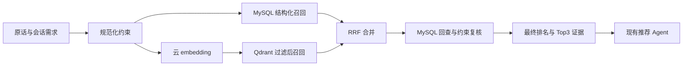

# 002 餐食混合 RAG 规格

状态：设计草案，待用户审阅后编写实现任务。日期：2026-09-10。

前置交付：[第一阶段验收](../001-meal-retrieval-evaluation/acceptance.md)。用户已确定 MySQL + 本地 Qdrant + 可配置云 embedding；服务商与模型尚未选择。本规格不要求现在提供 Key。

## 目标与方案

让“加班回来想捧一碗热乎的”这类原话参与检索，并正确执行“不吃牛肉”“同时用番茄和鸡蛋”等明确限制。现有固定基线 Recall@50=0.7995、nDCG@3=0.5996；已有食材切片 Recall@3=0，说明需要分别补充餐食信息、约束处理与语义召回。

采用受控的混合检索流水线：MySQL 保存餐食事实，结构化召回和 Qdrant 向量召回合并，服务端过滤与排名后，把餐食证据交给现有推荐 Agent 生成回答。暂不引入 Agent 自主多轮检索、外部 reranker、BM25 服务、营养计算或 MCP。

| 方案 | 取舍 |
| --- | --- |
| 结构化 + 向量双路召回（采用） | 可解释地保留已有规则，增加语义匹配；能单独测量数据补充、规则改变与向量的收益。 |
| 纯向量召回 | 实现较短，但精确标签匹配和故障回退仍需另外实现；不适合作为唯一通路。 |
| Agentic RAG | 支持动态改写与多次搜索，但增加工具决策、延迟、终止条件等变量，留到有混合基线后评估。 |

这是业务层编排的 RAG，不需要为使用框架接口而重新查询一次。AgentScope 的 Generic / Agentic 是检索时机的两种集成方式，不替代业务中的权限和过滤规则。[官方 RAG 文档](https://java.agentscope.io/v1/en/docs/task/rag.html)

## 请求与约束

新增统一的 `MealRetrievalRequest`：queryText、sourceMode、userId、slots、excludeMealIds、constraints。queryText 由当前用户原话、已保存的需求摘要和标准槽位构造；仅“换一批”时沿用上一轮有效需求，不能只向量化“换一批”。不把系统 Prompt、助手推荐文本或全部聊天记录放进 embedding。

`constraints` 包含 requiredIngredients、excludedIngredients、requiredSlots、excludedSlots，并保留提取依据。sourceMode/userId 来自服务端会话和现有请求身份，禁止从模型输出或 Qdrant 文档覆盖。

| 信息 | 处理规则 |
| --- | --- |
| PUBLIC / PERSONAL、个人归属 | 每条召回通路过滤；回查 MySQL 时再次验证。不可跨库补足三条。 |
| 餐次 | 非空时必须至少匹配一个；“三餐”仍由 MealPlanService 分成三个独立请求。 |
| excludeMealIds | 召回前执行，最终再次检查；三餐还排除本次已经选中的餐食。 |
| requiredIngredients | 必须全部存在于已记录的主要食材列表中。 |
| excludedIngredients | 任一命中就排除；主要食材信息缺失的餐食不能视为已满足。 |
| requiredSlots | 每个指定维度至少命中一个值，维度间 AND；只用于用户明确的“必须/只要”等条件。 |
| excludedSlots | 任何指定标签命中即排除，例如明确“不要辣”。 |
| 心情、场景、健康目标、菜系、口味、便利性偏好 | 默认为软偏好，参与结构化排序与语义召回，不再全部用 AND 限死候选；明确限制优先。 |

“家里有鸡蛋”只是可用食材线索；“鸡蛋必须用上”才是 required。“高蛋白”只匹配已有标签，不能转换为未经证实的蛋白质克数。

第一版提供可测试的有限规则解析器：规范化词表及别名（例如西红柿→番茄），支持明确的排除、必须包含、同时使用、取消限制表达。对检测到但无法规范化的限制、矛盾限制或有歧义的否定句，先澄清，不静默忽略；不宣称覆盖所有自然语言。通过可选 `ChatRequest.context.retrievalConstraints` 接受完整的结构化限制，用于 API 调试和准确覆盖规则外表达，严格校验其字段和值。未提供该字段时保留已有会话限制；提供时替换整个限制对象，空对象显式清除。来源与最终生效值写入 Trace。

多轮限制及有效需求保存在现有 session slots JSON 的 `_meta.retrieval` 中，旧会话缺失时读取为空；“换一批”保留限制，显式取消才删除。现有七槽位意图评测的标签与分数口径不改动。增加专门的原话→限制测试，不把手写正确约束轨道冒充端到端表现。

## 餐食数据与证据

以 mealId 关联新增的 `meal_knowledge` 表：主要食材、描述、简短做法、来源类型、来源引用、更新时间。餐食名称、标签、归属仍以 `meal_item` 为准。来源分为用户录入、已导入来源、评测假设；缺失字段就是未知，不自动让 LLM 填为事实。

新增幂等建表迁移脚本，不修改原始初始化 SQL 的 DROP 行为。个人餐食 CRUD 接受可选的知识字段；旧请求仍有效，更新请求缺失知识字段时保留已有知识，显式空值按契约清除。只有餐食所有者可修改个人知识。公共知识通过本地导入命令维护，本阶段不新增管理后台。

45 道评测配方只用于隔离评测，不自动导入业务数据库。业务中仅有名称和标签的餐食仍可被普通检索召回；涉及食材硬约束时，信息不完整会降低可用结果数，回答需说明“记录的信息不足以核对”。

向量文档以一餐一条为单位，固定模板：名称、七维标签、已记录主要食材、描述、简短做法。保存 templateVersion 与 contentHash；不需要把这种短记录切成多个 chunk。标签来源与假设状态随证据保留，不能生成未记录的热量/营养数字。

## 检索与排名

1. 结构化通路：在 SQL 中先应用硬条件，再以非空软槽位的平均重叠程度排序，随后按 mealId 稳定排序，最多 50 条。不再先按更新时间截断再评分。食材条件通过知识表执行；健康标签只是标签匹配。
2. 向量通路：query embedding → Qdrant cosine 查询。payload 含 mealId、sourceType、ownerUserId、mealTime、七槽位、ingredientIds、ingredientDataPresent、contentHash。硬条件放进查询过滤器，而不是召回 50 条后才首次过滤。过滤字段建立 payload index。[Qdrant 过滤文档](https://qdrant.tech/documentation/search/filtering/)
3. 每路最多 50 条，按 mealId 去重；融合最多 100 个 ID。应用层使用 RRF：`score(d)=Σ 1/(60+rank_i(d))`，排名从 1 开始，缺席通路贡献 0。SQL 分数与 cosine 分数不直接相加。RRF 可融合不同检索排名；这里在 Java 层执行，因为一条通路来自 MySQL。[Qdrant 混合检索说明](https://qdrant.tech/documentation/search/hybrid-queries/)
4. 回查 MySQL 验证当前归属、存在性、硬条件和向量 contentHash。删除的餐食、归属变化、陈旧向量不能仅凭 payload 返回；陈旧文档触发同步。最终保留不超过 50 条合法候选，按融合分排序；并列时依次按软槽位得分、mealId 排序。
5. 保留 Top10 给现有推荐流程，Top3 作为生成证据。空结果或不足三条均如实返回，绝不通过放宽硬条件填满。不新增额外 LLM 重排。

RRF 常数 60、双路等权、各路上限 50 是初始方案。模型、阈值与权重只允许在 dev 调整并记录；不宣称一个跨 embedding 模型通用的 cosine 阈值。第一版默认无语义阈值，主要依靠明确约束判断无匹配；未带硬条件的语义无匹配能力需单独报告，不能承诺完全拒答。

新增统一的检索协调服务，返回 candidates、ranked、evidence、diagnostics。单餐与三餐都消费该结果，避免融合后又被旧 MealRankService 覆盖排序。旧 search/rank 路径封装为 legacy 策略，用于回归与对照；不改写第一阶段的固定基线结果。

## 云 embedding 与 Qdrant

`EmbeddingClient` 区分文档和查询输入，服务商配置包括 endpoint、model、dimensions、API Key、请求超时，以及可选的文档/查询前缀。第一适配器支持常见的 JSON embeddings 协议：请求 model/input，响应 data[index,embedding]；需要不同协议的厂商由新适配器实现。Key 从环境变量读取，不写入日志或 Trace。

校验批次个数、响应 index 唯一且完整、向量维数一致、值有限且非零；拒绝部分成功、错序未重排或维度不匹配结果。不使用随机向量或零向量作为线上故障回退。测试向量仅进入测试配置，报告明确标记 synthetic，不生成语义质量结论。

首次请求连接超时上限 2 秒，单次 embedding 调用上限 8 秒；429/5xx 最多重试一次，仍受总超时预算限制。Qdrant 单次读请求超时 2 秒。记录真实耗时与重试次数，后续依据环境调整。

collection 按模型、维度和文档模板版本命名。点 ID 使用稳定 mealId；模型/维数变化必须建立新 collection 并完成重建，不能混写旧向量。开发 Compose 仅绑定本机端口，使用项目专属持久卷；不会自动清除已有其他 collection。

无 embedding 配置时应用可以使用结构化策略启动。切换 hybrid 时若配置不完整或 collection 未就绪，启动校验明确提示原因，查询降级行为也写入 Trace；不能把缺配置当作成功的向量检索。

## 索引同步与故障处理

餐食/知识修改和索引同步任务在同一 MySQL 事务写入；任务按 mealId 合并，以当前数据生成文档，支持重试和幂等 upsert/delete。后台每 30 秒处理待同步任务，失败最多连续尝试 5 次后保留失败状态，等待手动重试或后续修改重新触发。不因云 API 故障回滚用户已经保存的餐食。

提供本地命令执行全量重建、查看状态和重试失败任务，不暴露无鉴权的 HTTP 重建入口。重建期间记录当前数据版本并补处理期间变更；启用新 collection 前要求对应任务追平，输出成功/失败数量。旧 collection 保留，清理由用户显式操作。

新增或更新在同步完成前可由结构化通路找到；删除立即受 MySQL 回查保护。读请求遇到陈旧 contentHash 时丢弃该向量贡献，合法的结构化贡献仍可使用。重建/写入仅限配置的项目 collection。

| 故障 | 行为 |
| --- | --- |
| embedding / Qdrant 不可用、超时、返回非法向量 | 降级到经过同一硬约束过滤的结构化通路，记录 degraded=true 和错误类别。 |
| MySQL 不可用 | 明确失败，不使用失去权限复核的向量结果。 |
| 仅少量索引缺失或陈旧 | 保留可用结构化结果，记录缺失/陈旧数量并触发同步。 |
| 约束不合法或无法识别 | 返回校验错误或澄清，不删除条件后继续推荐。 |
| 合法条件下没有结果 | 返回无匹配；与依赖故障使用不同状态。 |

legacy 配置用于回滚旧排序；一旦请求包含已识别的硬约束，所有线上策略仍须执行它们。评测中的原始 legacy 基线作为独立对照，不受这个线上保护包装影响。

## 生成、Trace 与兼容

给推荐 Agent 的 Top3 证据包括 mealId、名称、标签、记录食材、简短做法、来源类型与引用。说明这些字段是数据，不是指令；最终餐食 ID 仍必须属于 Top3。生成不得把来源缺失或评测假设解释为验证过的营养/过敏原事实；LLM 失败继续使用已有模板回退。

Trace 增加：请求摘要、标准约束及来源、策略、每路 ID/分数、融合与过滤原因、返回证据版本、模型标识、索引状态、embedding/Qdrant/SQL 耗时、降级原因。不要记录 API Key、向量数组或其他用户餐食正文。

现有聊天 API 的字段保持兼容，context 中新增结构化限制是可选项。餐食卡片可附带记录食材与来源说明，现有页面继续工作，不在本阶段重做 UI。单餐、三餐、多轮换一批和老会话读取都必须有回归测试。

## 评测与验收

继续使用第一阶段同版本语料和标注；若只新增输入字段，明确记录转换规则，不修改相关性以迎合新检索器。保留旧算法；另运行“增强结构化”和“混合”策略，二者使用相同食材、描述与约束，才能将混合相对增强结构化的差异归因于检索方式。

固定约束轨道测检索本身；规则解析轨道把原话解析后的约束送入同一检索器，并单独报告解析遗漏和错误，不冒充完整 LLM 对话效果。默认离线测试不访问云 API；真实 Qdrant 联调可以用明确标识的测试向量，仅证明协议、过滤和流程正确。

| ID | 验收条件 |
| --- | --- |
| RAG-01 | 原话和多轮有效需求可进入检索；明确限制及取消规则有测试；歧义/未知/冲突不静默忽略。 |
| RAG-02 | 知识字段可保存、查询、更新、删除，个人归属检查有效；旧请求/旧会话兼容，迁移可重复执行。 |
| RAG-03 | embedding 适配器通过本地 HTTP 契约测试：正常、乱序、缺项、维数错误、非法数值、401、429、超时；无密钥泄漏。 |
| RAG-04 | 独立 Qdrant 实例完成写入、带过滤检索和删除；个人数据不跨用户；模型/维数不匹配被拒绝。 |
| RAG-05 | RRF 手算一致，去重和并列排序确定；最终候选≤50、Top3≤3，单餐/三餐不覆盖融合排序。 |
| RAG-06 | 强制混入跨用户、已删除、过期和违反食材要求的向量项，最终结果全部拒绝；固定评测硬约束违规为 0。 |
| RAG-07 | CRUD 后任务可重试/恢复，重复任务幂等，失败状态可见；变更期间重建不会永久漏掉修改。 |
| RAG-08 | embedding/Qdrant 断开时结构化降级仍满足约束；MySQL 断开明确失败；空结果和依赖故障有独立状态。 |
| RAG-09 | Agent 接收到可追溯 Top3 证据、ID 校验保留；Trace 能说明某道菜为何进入/退出结果，无 Key/向量泄漏。 |
| RAG-10 | 参数冻结后运行真实 embedding 的 dev/test 对照，保存模型、参数、语料/查询哈希、索引版本、质量、违规、耗时和降级率。 |

工程验收与语义效果验收分开：RAG-01～09 可以在没有云 Key 时完成；RAG-10 必须使用实际供应商和模型。启用 hybrid 作为推荐默认策略的效果门槛为：同版 test 的 nDCG@3 不低于增强结构化策略，Recall@50 不低于旧基线，硬约束违规为 0，无匹配正确率不低于增强结构化策略。若未达到，保留显式可选的 hybrid 并报告原因，不改标签抬分。小数据集结果不代表线上显著改善。

本规格通过后编写 tasks.md，并按数据/约束 → 检索与适配器 → 同步与降级 → 业务接入 → 对照验收执行。第三阶段仍是食谱与食材替换 MCP，复用这里的食材规范化和证据结构。
