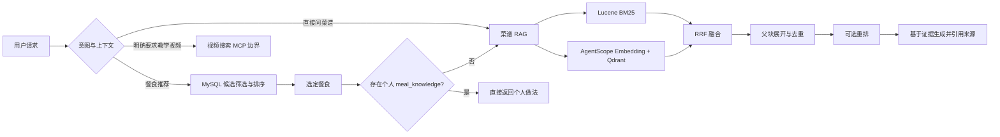

# 004：菜谱 RAG 与餐食推荐解耦

**状态**：已完成会话设计确认，等待书面规格复核

**日期**：2026-09-30

**范围**：移除餐食推荐 RAG，建设独立菜谱 RAG；视频 MCP 仅保留后续扩展边界

## 1. 背景与问题

当前项目把餐食推荐候选同时交给 MySQL 与向量检索处理。这个设计让推荐链路依赖 embedding 服务与 Qdrant，但餐食数量有限、筛选条件结构化，向量召回带来的收益难以抵消索引维护、故障处理和响应时间成本。

本阶段重新划分职责：

- MySQL 负责“今天吃什么”的餐食候选筛选与排序；
- RAG 负责“这道菜怎么做”的公共菜谱检索、证据组织与回答生成；
- 用户自建餐食的做法作为业务数据保存在 MySQL，不进入公共向量库；
- 教学视频属于外部内容发现能力，只在用户明确提出时调用 MCP，当前阶段只保留接口边界。

这一划分允许用户直接查询菜谱，不要求先执行餐食推荐；推荐完成后的追问也可以把已选餐食作为菜谱查询上下文。两条路径共享菜名等业务标识，但不存在调用顺序上的强依赖。

## 2. 目标

1. 删除实验性的餐食 embedding、餐食 Qdrant collection、餐食 RRF 与餐食索引任务，不再用 RAG 生成推荐候选。
2. 保留并强化 MySQL 餐食推荐，确保没有 Qdrant 或 embedding 服务时推荐仍可用。
3. 保留 `meal_knowledge`，使用户创建餐食时可以选择性维护食材、简介和做法。
4. 基于固定版本的 HowToCook 语料建设独立菜谱知识库。
5. 实现 BM25 与向量召回并行执行的混合检索，支持父子分块、RRF、可选重排和可选查询改写。
6. 建立可复现的菜谱检索与回答评测，覆盖召回质量、答案忠实度、拒答行为和并行检索性能。
7. 为后续“搜索哔哩哔哩或抖音教学视频”的 MCP 留下稳定接口，但本阶段不接入真实平台。

## 3. 非目标

- 不使用向量检索决定推荐哪一道餐食。
- 不把用户私有菜谱写入公共 Lucene 或 Qdrant 索引。
- 不在本阶段实现营养计算、卡路里估算或营养 MCP。
- 不在本阶段抓取、下载或转存视频网站内容。
- 不构建复杂的多租户知识库管理后台。
- 不把外部菜谱自动覆盖用户维护的餐食做法。

## 4. 核心架构



### 4.1 餐食推荐链路

推荐继续使用现有 `meal_item` 数据与 MySQL 查询。数值条件、餐型、标签和用户偏好由确定性逻辑筛选与排序。

用户明确提出食材包含或排除条件时，系统通过 `meal_knowledge` 中的结构化食材数据做 MySQL 关联过滤。若相关餐食没有足够的结构化数据，系统不得把“未知”当作“符合条件”；应返回可解释的无结果或要求用户放宽条件。系统不得静默忽略显式约束。

推荐链路必须满足：

- embedding、Qdrant、Lucene 全部不可用时仍能完成普通餐食推荐；
- 推荐结果不受公共菜谱索引是否构建的影响；
- 餐食推荐评测继续使用阶段 001 的固定数据集和 MySQL 基线；
- 菜谱 RAG 的评测不得混入阶段 001 的推荐指标。

### 4.2 个人餐食与做法

`meal_item` 与 `meal_knowledge` 保持一对零或一关系：

- 创建或更新餐食时，`knowledge` 为可选字段；
- 有 `knowledge` 时写入或更新 `meal_knowledge`，没有时只保存餐食主体；
- 保存个人做法不依赖菜谱 RAG 的启用状态；
- 删除餐食时由现有外键策略同步处理其知识记录；
- `source_type` 使用 `USER_PROVIDED`，保留可选的 `source_reference`；
- 用户内容只参与该用户的直接做法查询和确定性食材筛选，不进入公共向量索引。

当用户询问已选中的个人餐食如何制作时，优先返回该餐食的 `meal_knowledge`。仅当做法缺失时，才以规范化菜名查询公共菜谱 RAG，并在回答中明确这是公共参考菜谱。

### 4.3 公共菜谱 RAG

公共菜谱 RAG 使用独立包与独立配置前缀，例如 `com.diet.service.recipe.rag` 和 `diet.recipe-rag.*`。它不得复用带有“meal retrieval”语义的类名、集合名或数据表。

初始技术栈：

| 能力 | 实现 |
| --- | --- |
| 语料 | 固定 Git 版本的 HowToCook `dishes/**/*.md` |
| 解析 | Java Markdown/文本解析器，按标题与语义段落提取 |
| 稀疏检索 | Apache Lucene BM25 |
| 向量抽象 | AgentScope Java `EmbeddingModel` 适配器 |
| 本地开发 embedding | AgentScope `OllamaTextEmbedding`，模型名与维度由配置提供 |
| 云端 embedding | AgentScope 支持的实现或自定义适配器，通过同一应用接口切换 |
| 向量存储 | 本地 Qdrant，使用独立 recipe collection |
| 并发编排 | Reactor `Mono`，稀疏与向量检索并行 |
| 融合 | 确定性的 Reciprocal Rank Fusion |
| 重排 | 可配置开关；关闭时不影响核心检索 |

AgentScope 在这里承担统一客户端与模型抽象，不被描述为本地 embedding 服务本身。开发环境默认由本地 Ollama 提供推理；部署环境可以仅通过配置更换为云服务。

## 5. 语料与授权

### 5.1 来源

- 菜谱正文直接来自 [HowToCook](https://github.com/Anduin2017/HowToCook) `1.6.0`，固定 commit 为 `a0b14bd388ee996943173679c3a7c9db7da04a6c`，而不是从 All-in-RAG 的运行产物反向复制。
- [All-in-RAG](https://github.com/datawhalechina/all-in-rag) 只作为 RAG 流程、切分与评测方法的参考来源，本规格固定参考 commit `583a61b09869bc3afc4552289171f6ec188f2c76` 的第八章。
- 索引清单记录仓库地址、commit SHA、文件路径、内容哈希、导入时间和解析器版本。

### 5.2 授权边界

- 固定的 HowToCook commit 以 [Unlicense](https://github.com/Anduin2017/HowToCook/blob/a0b14bd388ee996943173679c3a7c9db7da04a6c/LICENSE) 发布；每次更新语料版本前仍需重新检查目标 commit 中的授权文件。
- 固定的 All-in-RAG commit 在 README 中声明 CC BY-NC-SA 4.0。项目文档说明方法参考并给出归属；实现采用本项目的 Java 设计，不直接复制其 Python 代码。
- 每个回答引用 HowToCook 的菜名与相对源文件路径；产品层可以进一步映射到固定 commit 的源链接。

## 6. 文档模型与索引

### 6.1 父子分块

每道菜谱形成一个父文档，至少包含：

- `recipe_id`：由固定版本、相对路径和内容哈希稳定生成；
- 菜名、别名与分类；
- 原始相对路径和固定 commit；
- 完整食材列表、步骤、备注；
- 内容哈希与解析器版本。

子块按“食材、准备、步骤组、备注”等标题和段落边界生成。每个子块保存 `parent_recipe_id`、块类型、顺序、文本和内容哈希。不得只按固定字符数粗暴切断步骤；超长段落可以二次按句子切分，并保留重叠窗口。

检索命中子块后回到父文档组装上下文。相同父文档的多个命中先聚合，避免同一道菜挤占全部 top-k。

### 6.2 增量构建

索引任务以内容哈希判断新增、更新与删除：

- 解析失败的文件进入失败清单，不覆盖上一版可用索引；
- Lucene 与 Qdrant 都构建成功后才切换活动索引版本；
- 任一侧失败时保留上一版活动索引；
- 重建过程可重复执行，相同输入产生相同文档 ID；
- Qdrant collection 名不得使用旧餐食 RAG 的 collection。

## 7. 查询与回答流程

### 7.1 查询入口

支持两种等价入口：

1. 用户直接问“宫保鸡丁怎么做”，直接进入菜谱 RAG；
2. 用户先获得 MySQL 推荐，再问“这道菜怎么做”，编排层携带已选 `meal_id`：先查个人做法，缺失时再查询公共菜谱。

因此，MySQL 推荐是可选的上游上下文，不是菜谱 RAG 的前置依赖。

### 7.2 查询理解

查询解析至少提取：菜名或主题、包含食材、排除食材、厨具限制、耗时要求和用户明确要求保留的词。

查询改写是可配置实验项。启用时必须：

- 原样保留否定条件、过敏信息、菜名和核心食材；
- 同时保留原始查询，允许检索器分别使用原始和改写查询；
- 在评测报告中单列收益与失败案例；
- 改写失败或超时后回退原始查询。

### 7.3 并行混合检索

Lucene BM25 与 Qdrant dense retrieval 在同一请求内并行启动：

- 两个分支分别设置超时、指标与错误记录；
- 单个分支失败时可以降级使用另一个分支；
- 两个分支都失败时返回可解释错误，不生成无证据答案；
- RRF 使用固定 `k` 和确定性二级排序，确保同一索引与查询得到稳定结果；
- 支持 `bm25`、`dense`、`serial_hybrid`、`parallel_hybrid` 等显式运行模式，用于消融实验；
- `serial_hybrid` 仅用于评测对照，不作为生产默认模式。

并行实现的正确性测试必须证明两个分支在时间上重叠，并验证其融合结果与相同输入下的串行混合结果一致。性能报告记录各分支、融合、父块展开、重排与总耗时的 p50/p95，不用单次本机耗时宣称生产 SLA。

### 7.4 重排与证据组装

重排器位于 RRF 与父文档最终截断之间，并由配置控制：

- 不配置重排服务时系统正常工作；
- 重排失败或超时后使用 RRF 顺序；
- 重排不得引入检索候选之外的菜谱；
- 报告必须同时给出启用和关闭重排的指标与延迟。

上下文组装遵守 token 预算，优先保留命中步骤附近的内容、完整食材表和来源元数据。多个来源冲突时分别呈现，不能拼接成没有来源支持的新步骤。

### 7.5 生成与拒答

生成模型只能依据检索到的父文档回答，并返回结构化引用。回答至少包含菜名、食材、步骤和来源；用户带约束时说明约束是否被满足。

出现以下情况时拒绝给出确定做法或明确说明证据不足：

- 无候选达到最低相关性阈值；
- 候选不包含回答所需的关键步骤；
- 用户要求的排除食材与候选菜谱冲突且无法从证据中找到替代方案；
- 所有检索分支均失败。

## 8. 旧餐食 RAG 的删除边界

### 8.1 删除

- 餐食 `EmbeddingClient` 与 HTTP embedding 实现；
- 餐食 `QdrantVectorStore`、向量 collection 配置和餐食文档向量化；
- 餐食 `ReciprocalRankFusion`；
- `MealIndexService`、`MealIndexCommand` 及索引 worker/rebuild 入口；
- `MealRetrievalService` 中的 dense、hybrid、降级策略与相关配置；
- 仅验证餐食向量/混合检索的单元与集成测试；
- 阶段 002 的餐食 RAG 实现文档和运行配置；
- 仅服务于餐食向量索引的任务表与进度表。通过新的数据库迁移删除这些派生表，不修改已经应用过的历史迁移文件。

### 8.2 保留或重构后保留

- `meal_item` 与 MySQL 推荐查询；
- 阶段 001 的餐食推荐固定评测集、基线和报告工具；
- `meal_knowledge` 表及用户已经维护的数据；
- `MealKnowledge`、`IngredientCatalog` 和仍被做饭流程使用的领域模型；
- `MealConstraints`、`ConstraintParser`、`RetrievalContext` 中与确定性约束或会话上下文有关的能力；必要时重命名和迁移包，去掉错误的 RAG 语义；
- 个人餐食知识的保存、查询和删除能力。原 `JdbcMealRetrievalStore` 需要拆为职责明确的知识存储与推荐过滤组件，不因删除 RAG 而丢失这些功能。

### 8.3 数据安全

迁移不得删除 `meal_item` 或 `meal_knowledge`，也不得清空用户已维护的做法。删除的索引任务与进度表只包含可重建的派生状态。迁移测试必须先写入个人餐食与知识记录，执行迁移后验证这些记录仍存在且可读取。

## 9. 视频搜索 MCP 边界

当前阶段只定义工具契约与 provider 接口，例如：

```text
search_cooking_videos(query, platform?, limit?)
  -> [{title, platform, url, creator?, publishedAt?, snippet?}]
```

规则：

- 只有用户明确要求“视频、跟做、教程链接”等内容时才调用；
- 普通餐食推荐和菜谱问答不等待 MCP；
- 默认 provider 为 disabled 或 fake，便于测试；
- provider 有独立超时与失败降级，失败不影响文字菜谱；
- 未来接入哔哩哔哩或抖音时优先使用官方或明确授权的接口，平台凭据不进入仓库。

真实平台实现、排序策略与内容安全处理另立规格，不属于本阶段验收。

## 10. 配置与可运维性

建议配置域：

```yaml
diet:
  recipe-rag:
    enabled: false
    corpus:
      repository: "Anduin2017/HowToCook"
      commit: "a0b14bd388ee996943173679c3a7c9db7da04a6c"
    retrieval:
      mode: parallel_hybrid
      bm25-top-k: 20
      dense-top-k: 20
      final-top-k: 5
      rrf-k: 60
    embedding:
      provider: ollama
      model: "bge-m3:567m"
      dimension: 1024
    reranker:
      enabled: false
```

初始基线使用 HowToCook `1.6.0` 与 Ollama `bge-m3:567m`（1024 维）；二者都写入可版本化的导入清单和评测报告，不能依赖浮动分支或代码内密钥。应用启动时验证 embedding 维度与 Qdrant collection 一致；不一致时禁止写入并报告明确错误。后续可以配置云 embedding，但切换模型后必须新建索引版本并重新跑完整评测，不能把不同模型的分数直接合并。

至少暴露以下指标：

- 检索模式、命中数、降级次数与空结果率；
- BM25、dense、融合、父块展开、重排和总延迟；
- 当前语料 commit、索引版本与文档数；
- embedding 与 Qdrant 调用错误；
- 生成拒答率和引用覆盖率。

日志不得记录用户完整私有做法、凭据或未经脱敏的敏感健康信息。

## 11. 评测设计

### 11.1 数据集

从固定 HowToCook commit 建立独立的菜谱评测集，保存查询、相关 `recipe_id`、相关等级、查询切片和标注说明。数据集分为开发集与锁定测试集；开始比较方案后不得根据测试集结果修改 qrels。

查询切片至少覆盖：

- 精确菜名与别名；
- 食材反查菜谱；
- 做法或技法描述；
- 包含/排除食材；
- 厨具或耗时限制；
- 多条件长查询；
- 语义表达与关键词不重合；
- 语料外问题与应拒答问题。

所有评测产物记录语料 commit、索引版本、embedding provider/model/dimension、检索参数、应用 commit 和运行环境。

### 11.2 检索指标

至少计算：

- Recall@1、Recall@5、Recall@10；
- MRR@10；
- nDCG@10；
- Parent Recall@K；
- top-k 父文档重复率；
- 空结果率；
- 每阶段与端到端 p50/p95 延迟。

### 11.3 回答指标

回答评测至少包含：

- 引用覆盖率：关键结论是否有来源；
- 忠实度：食材、数量和步骤是否能在引用证据中找到；
- 完整性：是否覆盖用户要求的关键内容；
- 约束遵循：排除食材、厨具和耗时要求是否被正确处理；
- 拒答准确率：语料外或证据不足时是否停止编造。

确定性规则优先自动计算。LLM judge 只作为单独维度，保存模型、prompt 版本和原始判定，不与可重复的检索指标混为一个总分。

### 11.4 消融矩阵

同一评测集至少比较：

1. BM25；
2. dense；
3. 串行 BM25 + dense + RRF；
4. 并行 BM25 + dense + RRF；
5. 并行混合 + 父块展开；
6. 并行混合 + 父块展开 + 重排；
7. 在表现最好的稳定配置上启用查询改写。

串行与并行混合在相同候选和参数下必须返回相同的排序结果；二者主要比较并发正确性、总延迟和失败降级。报告按查询切片展示质量与成本，不能只给整体平均分。

## 12. 验收标准

- **RRAG-01**：删除旧餐食向量检索后，在 embedding、Qdrant 和 Lucene 均关闭的环境中，MySQL 餐食推荐测试通过。
- **RRAG-02**：显式食材约束由确定性 MySQL/领域逻辑处理，不会被静默忽略。
- **RRAG-03**：数据库清理迁移执行后，已有 `meal_item` 与 `meal_knowledge` 完整保留，旧餐食索引派生表被移除。
- **RRAG-04**：创建、更新和读取个人餐食做法不依赖 `diet.recipe-rag.enabled`。
- **RRAG-05**：直接菜谱查询无需先执行餐食推荐；推荐后的追问能通过 `meal_id` 优先命中个人做法并正确回退公共 RAG。
- **RRAG-06**：固定 HowToCook commit 可重复生成相同父子文档 ID，索引清单包含来源与内容哈希。
- **RRAG-07**：BM25 与 dense 分支并行启动；单分支失败可降级，双分支失败不生成无证据答案。
- **RRAG-08**：串行混合与并行混合在固定输入下排序一致，性能报告包含分阶段和端到端 p50/p95。
- **RRAG-09**：父块展开后最终 top-k 按菜谱去重，并保留可定位到固定 commit 文件的引用。
- **RRAG-10**：重排与查询改写均可独立关闭，失败时回退且不破坏核心检索。
- **RRAG-11**：评测报告包含规定的检索、回答、切片和消融结果，并锁定测试集 qrels。
- **RRAG-12**：视频 MCP 使用 disabled/fake provider 完成契约测试，普通推荐与菜谱回答不会隐式调用它。

## 13. 实施顺序

1. 先锁定阶段 001 的 MySQL 推荐回归测试，并补充个人知识数据保留测试。
2. 删除旧餐食 RAG 与派生索引状态，重构个人知识存储和显式食材过滤。
3. 固定 HowToCook 版本，完成语料清单、解析、父子分块与索引构建。
4. 实现 BM25、AgentScope embedding、Qdrant 与并行 RRF，完成故障降级。
5. 接入菜谱问答与个人做法优先逻辑，增加引用和拒答。
6. 完成评测集、消融矩阵、并行正确性与延迟报告。
7. 增加视频搜索 MCP 契约和 disabled/fake provider，不接真实平台。

每一步完成后运行相应回归；任何需要更改上述数据所有权、调用边界或语料授权的决定，都先更新本规格再实现。

## 14. 风险与处理

| 风险 | 处理 |
| --- | --- |
| 旧 RAG 删除时误删个人做法 | 数据迁移只删除派生索引表，并用迁移前后数据测试保护 |
| HowToCook 文件格式不一致 | 解析失败清单、解析器版本和上一版索引回退 |
| BM25 与 dense 延迟相互拖累 | 分支独立超时、并行执行和单分支降级 |
| embedding 模型切换导致维度冲突 | 启动校验；collection 与模型版本绑定 |
| 查询改写破坏否定条件 | 保留原查询、约束词不可删除、单独评测 |
| 回答模型补写不存在的步骤 | 结构化引用、忠实度评测和证据不足拒答 |
| 视频平台接口不稳定或授权受限 | 当前只定义 provider 边界，真实接入单独评审 |
