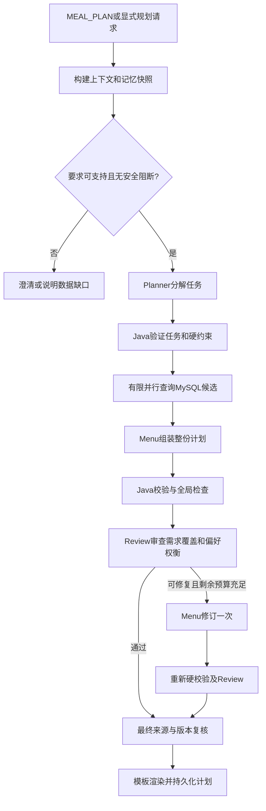

# 015 多 Agent 餐食规划技术方案

状态：首版工程实现与验收完成，默认关闭。设计日期：2026-10-20；实施日期：2026-10-21。

本文件保留设计依据。实际启用及边界见运行指南和验收记录；预算是建议初值，不是经压测的 SLA 或质量保证。

实施边界：首版范围契约使用同一餐次集合覆盖连续日期；逐日不同餐次、局部去重策略混用时先澄清，避免笛卡尔积添加用户未要求的餐次。真实模型三组对照及人工盲评尚待独立执行；受控工程测试不能证明质量收益。

## 1. 问题与目标

当前 `MealPlanService` 固定遍历早餐、午餐、晚餐：MySQL检索、重排、逐餐调用推荐回答Agent，且将当前餐次的全部推荐候选ID加入后续排除集合。它能输出三餐候选，但没有日期维度，也没有对整个计划的选择、需求覆盖与审查修订。

例如“未来三天只安排晚餐，尽量不重复；第一天清淡，后两天想吃川菜”需要识别日期/餐次和局部要求，对同一候选池做全局选择，而不是强制展开每日三餐。第一版目标是按请求组装真实餐食计划，允许保留不可满足的缺口，提供可追踪的有限修订。

### 第一版范围

- 1—3个连续自然日，每天早餐/午餐/晚餐的任意子集，最多9个任务；每任务选1道主餐，不擅自增加用户未要求的餐次。超过范围先澄清，不截断后假称完成。
- 输入“今天”“明天”“未来三天”由服务端结合Asia/Shanghai日期锚点规范化；日期不明则澄清。多个非连续日期、跨用户家庭档案、详细营养配餐暂不支持。
- “不要重复”作为可验证硬要求；“尽量不重复”作为软目标。候选不足时前者留缺口，后者可返回明确标记的重复项。不能擅自将硬要求改为软要求。
- 餐食候选只从MySQL获取；PERSONAL/PUBLIC严格择一，不自动混库。个人数据、meal数据和用户记忆不进入公共索引。
- 沿用014记忆：本人明确禁忌为硬约束，本轮明确要求优先于普通偏好；推断偏好只影响排序。没有过敏元数据时，过敏/待确认过敏保持当前保守阻断。
- 菜品没有可验证的价格、营养数值、完整用具和时长元数据时，标记相关要求UNSUPPORTED。需要用户明确放宽才能去掉硬要求，不把“高蛋白”标签说成精确营养达标。
- 做法/视频不在核心规划内自动检索。用户选择某道计划餐食后沿用现有独立菜谱域；视频仍需video-mcp profile。不会给所有候选批量启动RAG/MCP。

## 2. 方案选择

| 方案 | 优点 | 代价 | 结论 |
| --- | --- | --- | --- |
| 单模型一次生成 | 调用少，易实现 | 候选选择、约束与解释混合，难定位和修订 | 作为新增对照基线 |
| Java协调器 + Planner/Menu/Review | 角色职责与契约明确，可限制循环，复用现有服务 | 增加调用与尾延迟，收益需实测 | 推荐 |
| 自由Supervisor及任意子Agent对话 | 动态性更强 | 上下文与工具预算难控制，本任务收益不明确 | 第一版不采用 |

推荐方案准确称为“受控多Agent工作流”。三个角色不要求不同模型或微服务，角色边界通过输入、输出、权限和验证体现。Java协调器拥有状态流转和终止权。固定餐次并行查询是执行优化，不能单凭并行就宣称实现自主任务委派。

## 3. 职责与权限

| 组件 | 输入 | 输出 | 权限与边界 |
| --- | --- | --- | --- |
| PlanningContextBuilder（Java） | 身份、原消息、会话条件、记忆 | 不可变PlanningContext | 读取、规范化、记录来源；构建一次记忆快照 |
| Planner Agent | 原请求、日期锚点、已核验约束、支持能力 | PlanningSpec：任务及局部软要求，或澄清项 | 提议分解；不能改用户/数据源、删除服务端硬限制或写记忆 |
| CandidateProvider（Java） | 已验证任务和约束 | 每任务可选餐食ID及候选事实表 | 复用MySQL检索与排序；只读，不生成餐食 |
| Menu Agent | 任务、候选表、全局目标 | PlanDraft：每任务一个mealId或明确缺口，理由事实引用 | 只能选择对应任务候选；不执行SQL、不修改任务范围 |
| PlanValidator（Java） | 草稿、任务、候选快照、硬约束 | ValidationReport | 对合法性作最终裁决；不能被Review覆盖 |
| Review Agent | 原请求、合法草稿、事实表和验证结果 | 需求遗漏、体验问题及可定位修订项 | 语义审查，不代替硬校验；不输出替代数据库事实 |
| PlanRenderer（Java） | 最终验证通过的结构化计划 | 日期分组、事实化理由、缺口 | 依据允许的标签/食材/用户偏好模板渲染，不再增设自由生成Agent |
| MealPlanningCoordinator（Java） | 上述所有结果与执行预算 | COMPLETE/PARTIAL/DEGRADED/NEEDS_INPUT/UNAVAILABLE | 有限编排、版本检查、落库；唯一计划状态写入者 |

模型分配建议：Planner与Review先使用现有轻量模型，Menu使用主模型；若相同模型也可保持角色隔离。Jev可在后续作为审查清单的候选判断器，不作为首版强制依赖，也不据此认定满足营养/过敏要求。

## 4. 主链路



Planner输出非法时不会进入查询。Menu输出非法时先做确定性校验，只把具体错误和有限事实交回修订；涉及越权、候选外ID、约束篡改等不能作为部分计划的合法项。

### 4.1 先并行召回，再全局选择

独立任务的候选检索可并行，默认并发3。不能在各任务独立检索时排除其它任务的全部候选，否则会抢走尚未实际选择的稀缺餐食。只在整份草稿上检查最终选择的重复与餐次适配。

每任务起始最多5个候选；全局候选事实按mealId去重，最多60道，输入模型前按实际token预算缩减。候选快照必须保留每个任务的独立归属，不能拿其它任务的候选填补当前任务。

存在“无重复硬要求”时，服务端先对任务—候选图做最大匹配检查。若原候选池不可行，允许对候选不足的任务扩展一次至最多10个，并重新检查；这一步在Menu生成前完成，不额外增加模型调用。仍不可行则保留明确缺口，不宣称无解覆盖全部数据库。召回截断可能影响可行性，报告要记录扩展与截断状态。

### 4.2 全局权衡

Menu可以在合法候选之间权衡偏好匹配、历史已选餐食、跨日重复和菜系变化。Java从候选事实计算可核验指标；权重配置在代码/配置中，模型不能自行宣布满足硬要求。

当前库只有标签和部分食材/做法，第一版不计算精确营养平衡、采购费用、配料克数或总烹饪时长。无法验证的要求必须留在unsupportedConstraints，不能混进“已满足”。

### 4.3 有限审查修订

审查项结构包含：issueId、taskIds、constraintId、code、severity、evidenceRefs、suggestion。示例为“用户要求第二天清淡，但该任务遗漏了有来源的局部偏好”，而非笼统的“不够健康”。

仅允许Menu修订一次；修订输入包含已有草稿、冻结任务、候选表与可定位问题。不得更改日期/数据源/身份/硬限制，不重新做全量任务分解。最终仍须独立验证。

审查模型不可用时，确定性校验通过的草稿可作为DEGRADED输出，明确未完成语义复核。审查已明确指出未解决的需求遗漏时，不能静默降级为“审核不可用”；应标PARTIAL并展示缺口，或对硬要求返回NEEDS_INPUT。

## 5. 数据契约

使用Java record和严格JSON契约；所有Agent输出禁止额外字段、尾随文本、无限数组、未知枚举和悬空ID。用户文本/候选做法都是数据，不能成为角色指令。

### PlanningContext（服务端持有）

```text
requestId / traceId / sessionId / userId / sourceMode
anchorDate / timezone
originalMessage
memoryEpoch + memoryItemVersions
hardConstraints[]   // constraintId、type、value、scope、sourceRef
softPreferences[]   // 显式/推断来源、适用任务、权重
capabilities[]      // 当前可验证能力
deadline + executionBudget
```

来源区分CURRENT_MESSAGE、SESSION、CONFIRMED_MEMORY、INFERRED_MEMORY；硬限制在Java合并。模型不接收密钥，也不负责选择真实userId。

### PlanningSpec（Planner输出示例）

```json
{
  "tasks": [
    {"taskId":"d0-dinner","dayOffset":0,"mealTime":"晚餐","preferenceRefs":["pref-light"]},
    {"taskId":"d1-dinner","dayOffset":1,"mealTime":"晚餐","preferenceRefs":["pref-sichuan"]},
    {"taskId":"d2-dinner","dayOffset":2,"mealTime":"晚餐","preferenceRefs":["pref-sichuan"]}
  ],
  "clarifications": []
}
```

dayOffset由服务端映射成实际日期，taskId唯一，任务必须与已规范化请求范围一致。preferenceRefs只能引用服务端已识别、可追溯的偏好；新局部要求必须先成为原文支持的候选约束并经Java接受。

### PlanDraft（Menu输出示例）

```json
{
  "assignments": [
    {"taskId":"d0-dinner","mealId":101,"reasonFactRefs":["meal:101:healthGoal:清淡"]},
    {"taskId":"d1-dinner","mealId":208,"reasonFactRefs":["meal:208:cuisine:川菜"]},
    {"taskId":"d2-dinner","mealId":null,"reasonFactRefs":[]}
  ],
  "gaps": [{"taskId":"d2-dinner","code":"NO_DISTINCT_CANDIDATE"}]
}
```

示例ID仅演示契约，不代表数据库实际存在。reasonFactRefs由CandidateProvider构建；模型不能凭空引用标签或营养属性。候选空则mealId=null，并保留原因。

### ReviewReport

```text
decision: PASS / REVISE / NEEDS_INPUT
issues: [{issueId, taskIds, constraintId, code, severity, evidenceRefs, suggestion}]
```

PASS不能覆盖Java校验失败；Review提出的建议也必须受服务端能力和原始要求约束。

## 6. 硬校验与最终裁决

必须验证：

1. 任务范围、唯一性、日期与餐次覆盖；无多余任务或静默漏餐。
2. mealId属于当前任务的候选集合，且仍然存在；不能只检查全局候选集合。
3. sourceMode和ownerUserId符合可信请求身份，禁止自动混合公共与个人数据。
4. 本轮食材条件与长期禁忌均满足；食材信息缺失不能标成已核验。
5. noRepeat硬要求仅计算最终主餐ID，跨任务统一检查。
6. 每条理由引用真实存在且属于所选餐食的事实，标签不是营养数值证明。
7. 最终任务每项恰有一个合法选择或明确缺口；非法项移除后重新计算覆盖率和状态。
8. 输出前复核记忆epoch和候选内容快照。版本改变则返回CONTEXT_CHANGED要求刷新，不能把旧计划标为符合最新限制。

候选/记忆读取在请求内冻结一次，不让不同Agent分别读取不断变化的画像。最终复核只读，不回写长期记忆。计划反馈仍走014证据链。

现有MemoryPolicy及MealService会自行读取档案，实施时须增加接受可信MemorySnapshot的内部入口，让规划路径真正复用同一快照；不能仅在协调器保存一份快照，底层仍逐任务重读。快照由服务端构造，不能从客户端反序列化为可信约束。最终候选复核可对ID、归属及规范化事实做内容指纹比较，不假设现有餐食已具有版本字段。

最终状态由Java计算：全部任务合法覆盖且语义复核通过为COMPLETE；存在未填任务或未解决需求为PARTIAL；合法完整草稿因审查不可用而返回为DEGRADED；输入歧义或硬要求不支持为NEEDS_INPUT；全部检索失败为UNAVAILABLE。PARTIAL可以同时有reviewed=false等警告，不用DEGRADED掩盖缺口。确定性备用计划另以strategy标识，不能混入多Agent正常成功数。

## 7. Java与AgentScope实现方式

新增 `service/meal/planning`，保持现有 `MealPlanService` 为旧版基线。

```text
MealPlanningCoordinator      状态机、预算、降级、提交
PlanningContextBuilder      请求/记忆快照、能力检查
MealPlanningRequestParser   日期和范围的规范化/澄清
PlanningAgent               需求分解
MenuCompositionAgent        全局组装/一次修订
PlanReviewAgent             语义审查
PlanCandidateProvider       MySQL检索、扩展、事实表、匹配检查
PlanValidator               确定性校验
PlanRenderer                按事实模板渲染
PlanRepository              版本化计划持久化
model/*                     上述数据契约
```

复用当前AgentScope Model配置与无状态结构化调用方式。每个角色独立system prompt、输出schema和调用预算；每请求实例或无状态调用，不能并行复用并清空同一缓存ReActAgent的内存。

第一版候选工具由CandidateProvider托管调用；没有模型自由生成SQL的权限。无需升级SDK或引入新的Agent框架，也不依赖未经1.0.11验证的新API。

检索用Reactor有限并发及专用有界阻塞线程池，不在事件循环执行JDBC。数据源连接池还有其它请求，要保留余量。并行任务携带不可变上下文，并复用 `AgentTraceService.propagate` 传递Trace；不能假设ThreadLocal自动跨线程传播。Agent不并发写SessionState。

## 8. 执行预算与异常处理

首版建议配置如下，需通过开发评测/压测校准：

| 参数 | 建议初值 |
| --- | --- |
| 全局开关 | `diet.meal-planning.enabled=false` |
| maxDays / maxTasks | 3 / 9 |
| 检索并发 | 3，受数据库/全局容量进一步限制 |
| 每任务候选 | 初始5，最多扩展一次到10 |
| 去重事实表上限 | 60道，同时受输入token预算限制 |
| Planner / Menu / Review单次时限 | 5s / 8s / 4s |
| 规划子流程总预算 | 40s，从规划路由开始；前置记忆/意图耗时单独计入端到端 |
| 语义修订 | 最多1次，且剩余预算足够 |
| 角色模型调用上限 | 初始3次 + 修订Menu/Review各1次，最多5次 |
| 传输重试 | 模型maxAttempts=1，避免SDK隐式重试乘以工作流次数 |

每个阶段使用min(本阶段上限,剩余预算)，取消/超时后禁止继续启动后续阶段；底层JDBC还需配置查询超时，不能将Reactor取消当作SQL一定已终止。另记现有意图/记忆的模型调用，不混淆为规划预算内调用。

| 故障 | 行为 |
| --- | --- |
| 记忆不可用/过敏信息无法验证 | 沿用保守阻断，不绕过 |
| Planner失败或输出非法 | 可确定的结构化/标准范围由代码展开；含歧义则NEEDS_INPUT |
| 个别任务检索失败 | 标RETRIEVAL_FAILED，与NO_MATCH区分；其它任务可继续 |
| 候选不足 | 扩展一次；不放宽硬限制，输出明确缺口 |
| Menu失败或ID非法 | 对已验证任务候选使用确定性选择；有无重复硬约束时使用匹配解；必须再校验 |
| Review超时 | 硬校验通过才允许DEGRADED，显式标记未完成语义复核 |
| 一次修订仍失败 | 保留合法部分并报告问题；不能无限循环或静默声称完整 |
| 来源/记忆版本变更 | CONTEXT_CHANGED，不返回符合最新约束的保证 |
| 所有任务检索失败 | UNAVAILABLE，不能生成虚构计划 |
| 新流程不可用回退旧服务 | 仅旧服务能够表达相同范围和硬条件时使用；多日/仅晚餐不能回退成固定三餐 |

确定性备用选择也要输出所用策略和降级原因。其质量不能算作多Agent成功，评测单独统计。

## 9. API、持久化与前端

仍复用聊天入口，MEAL_PLAN或显式 `context.mealPlan` 路由新协调器。服务端校验结构化字段并保留原文；新字段仅允许日期范围、餐次及明确的去重要求，不允许指定userId、SQL、模型名或绕过禁忌。

`ChatResponse`建议新增可选 `mealPlan` 对象，不改变旧 `planBlocks`：

```text
mealPlan:
  planId / version / status / strategy / reviewed
  days: [{date, blocks: [{taskId, mealTime, selectedMeal, reason}]}]
  gaps / unsupportedConstraints / warnings
```

前端按日期展示，不能把多日任务折叠成没有日期的三餐。单日旧响应继续原样渲染。展示/反馈必须关联planId、planVersion、taskId、traceId和真实mealId；计划生成不等于用户采纳，不直接写成偏好证据。

新增MySQL `meal_plan` 与 `meal_plan_version`：保存可信用户归属、请求/记忆版本、状态、结构化任务和已选ID、来源事实快照、缺口、策略和审计信息。仅协调器提交最终可展示版本；Agent不能直接写计划或长期记忆。不在模型调用期间持有数据库事务。

首版不自动修改既有计划。“把第二天晚餐换掉”作为后续增量能力，需要计划版本与局部任务重算，不能仅靠会话最后推荐ID猜测。若首版遇到该请求，应明确要求重新规划对应范围，避免暗中改动其它餐次。

## 10. 观测与评测

Trace记录：PLAN_CONTEXT_READY、PLAN_SPEC_PROPOSED/VALIDATED、PLAN_CANDIDATES_FETCHED、PLAN_DRAFT_CREATED、PLAN_VALIDATED、PLAN_REVIEWED、PLAN_REPAIRED、PLAN_FALLBACK、PLAN_FINALIZED。每项包含planRunId、taskId、阶段、attempt、策略、Prompt/schema/model版本、耗时、usage（缺失为null）、候选数量、验证错误码与降级原因。原始敏感档案不复制到通用Trace。

### 三组对照

1. 旧三餐流水线：仅在相同的单日三餐子集比较，不拿其不支持的多日任务直接拼总体分数。
2. 单Agent组装：与新流程共享规范化任务、候选快照和硬校验，仅由一个模型组装整份计划。
3. 多Agent组：Planner/Menu/Review加有限修订。

同时做“是否加Review/是否允许修订”的消融。报告实际候选、完整/部分/降级状态，模型失败留在分母，不能只统计成功调用。模型/Prompt不同的差异不能全部归因于Agent数量。

### 数据与指标

规划任务没有唯一菜品金标，应标注日期/餐次、硬限制、软偏好、允许缺口及可接受选择集合。使用冻结MySQL测试快照，不根据输出挑选可答样本。

开发集覆盖单日/多日、仅晚餐、局部口味、重复约束、空库、食材未知、个别工具超时、错误ID、记忆变更、过敏阻断、数据源隔离。冻结另一个测试集后验收，近义需求按组划分；每组重复3次衡量稳定性，重复观测不能算更多独立样本。

主指标：任务完整成功率、合法任务覆盖率、硬约束违规数、未标记缺口数、重复率、事实引用有效率、人工偏好评分。工程指标：端到端与规划阶段P50/P95、实际HTTP/模型调用数、可观测token、修订成功率、降级率。人工盲评/明确rubric优先，在线Review不能同时充当唯一验收裁判。

工程验收门槛：构造的硬违规输出全部被Java拦截，用户/数据源越权为0，错误来源事实全部拒绝，循环/调用数不超过预算，失败任务不被伪装完成。只有独立对照证明质量收益且延迟成本可接受，才扩大启用；不能预写提升百分比。

## 11. 实施分期

1. 任务/上下文契约、日期解析、候选快照、确定性校验和失败状态；先为旧服务建立可比较基线。
2. Planner/Menu接入，新增日期分组结果，完成硬限制、匹配可行性和降级。
3. Review与一次修订、独立预算和Trace；完成多Agent/单Agent/消融对照。
4. MySQL计划版本、前端日期卡片和精确反馈；默认关闭，经开发与锁定测试集验收后再显式启用。

## 12. 设计依据

- [现有MealPlanService](../../../src/main/java/com/diet/service/meal/MealPlanService.java)：当前固定三餐循环、逐餐生成与记忆软排序。
- [014长期记忆边界](../014-user-memory/spec.md)：硬限制、软推断、过敏与数据缺口。
- [Anthropic：Building effective agents](https://www.anthropic.com/engineering/building-effective-agents)：工作流与Agent、并行和评价修订模式。此处采用受控工作流，不宣称动态自主Supervisor。

本方案不要求采用其它框架或当前 SDK 之外的新能力。当前入口见 [运行指南](../../guides/meal-planning.md)。
